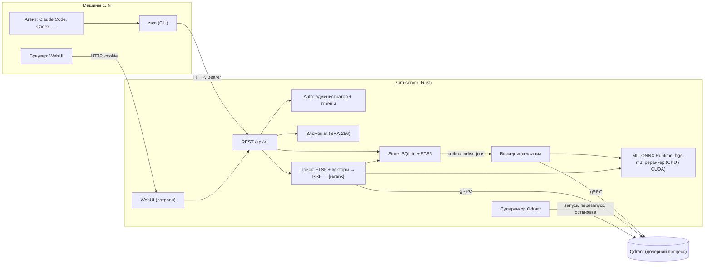

# ZeroAIMemory

[](https://github.com/ogoun/ZeroAIMemory/actions/workflows/ci.yml)

Централизованная человекочитаемая память для AI-агентов. Один самодостаточный сервер в
локальной сети хранит знания в виде дерева Markdown-заметок. Агенты (Claude Code, Codex и
другие) читают и пишут их через API по токену, человек — через встроенный WebUI.

> **Статус: ранняя разработка.** Выпущены этапы M0 и M1 (теги `v0.0.1-m0`, `v0.0.2-m1`),
> идёт этап M2 «Индекс и ML» (ветка `m2-index`). API и формат данных до версии 1.0 могут
> меняться. Ниже везде отмечено, что уже работает, а что только запланировано.

## Содержание

- [Зачем](#зачем)
- [Статус и дорожная карта](#статус-и-дорожная-карта)
- [Возможности](#возможности)
- [Архитектура](#архитектура)
- [Быстрый старт](#быстрый-старт)
- [Использование](#использование)
- [Требования к системе](#требования-к-системе)
- [Разработка](#разработка)
- [Документация](#документация)
- [Лицензия и сторонние компоненты](#лицензия-и-сторонние-компоненты)

## Зачем

В долгой работе над большим проектом агент забывает пройденное: повторяет уже разобранные
ошибки, заново пробует проваленные гипотезы, не знает, что решили в прошлой сессии или на
другой машине. ZeroAIMemory даёт ему общую память на все сессии, машины и проекты
пользователя:

- агент записывает решения, ловушки и результаты экспериментов и находит их потом гибридным
  поиском. Сервер отдаёт компактные карточки с точными ссылками на источник, а агент сам
  дочитывает нужное;
- человек видит всё, что агент «помнит», в виде обычных Markdown-заметок с историей
  ревизий, правит их в WebUI и может откатить любую правку;
- сервис работает без облака и внешних энкодеров: модели эмбеддингов и реранкера
  запускаются внутри сервера на CPU или NVIDIA GPU, генеративной модели на сервере нет.

Главный приёмочный сценарий «CRLF» (ТЗ §1.1). Агент в проекте A разобрал ошибку
`/bin/bash^M: bad interpreter` и записал инсайт с триггером `**/*.sh`. Через неделю в
проекте B на другой машине хук напоминает ему про LF до того, как он создаст `deploy.sh`.
Инсайты, триггеры и хуки появятся на этапах M3–M4.

## Статус и дорожная карта

Этапы и критерии готовности описаны в [ТЗ §19](docs/specs/2026-10-17-zeroaimemory-tz.md#19-этапы-реализации).

| Этап | Содержание | Состояние |
|---|---|---|
| **M0. Каркас** | конфигурация, `system.db`, базы пользователей, администратор, пользователи, токены, `/health`, WebUI-заглушка, `zam status`, конвейер релиза | выпущен, `v0.0.1-m0` |
| **M1. Заметки** | Markdown-заметки, секции и PATCH, ревизии, корзина, вложения, FTS5, CLI, WebUI с редактором | выпущен, `v0.0.2-m1` |
| **M2. Индекс и ML** | чанкинг, bge-m3 (ONNX, CPU/CUDA), управляемый Qdrant, очередь индексации, L0/L1, гибридный поиск, реранк, деградация, `index/status`, GPU-комплекты | в работе, ветка `m2-index` |
| M3. Журналы и граф | changelog, releases, insights с триггерами, vault, связи и вики-ссылки в графе | запланирован |
| M4. Агенты | MCP, `zam init`, хуки, `/recall`, кэш выжимок, страница «Подключение агента» | запланирован |
| M5. Документы | извлечение текста и просмотр DOCX, XLSX, PDF, PPTX | запланирован |
| M6. Экономия токенов | бюджеты и формат карточек по замерам, `promote` | запланирован |
| M7. Полировка | экспорт и импорт, `doctor`, бэкап и восстановление, администрирование | запланирован |

Что из M2 уже есть в ветке `m2-index` (см. раздел `[Unreleased]` в
[CHANGELOG.md](CHANGELOG.md)): чанкер §8.2, эмбеддер bge-m3 и реранкеры, супервизор
нативного Qdrant, воркер индексации с кэшем эмбеддингов, L0 заметок и папок, гибридный
`/search` с RRF и реранком, режим деградации до FTS, `GET /index/status`, reindex из кэша,
команды `models`, `cuda` и `qdrant`, комплекты cpu и gpu, архивы `zam-models` и `zam-cuda`,
e2e-тесты жизненного цикла Qdrant, страница «Индекс» в WebUI, строка деградации поиска и
значки индексации, `zam search --rerank`. Ещё не сделано: набор `eval/` и гейт качества, замеры производительности §17, прототип `qdrant-edge` с ADR, приёмка этапа.

## Возможности

Работает в выпущенных версиях (M0, M1):

- **Заметки и папки** в пространствах Knowledge, Rules, Human и в пространствах решений
  (проектов). Чтение целиком, по уровню (L0 — сводка, L1 — оглавление) или по секции
  (`Установка > Linux`). Замена с проверкой ревизии: при конфликте приходит 409 с диффом.
  PATCH секций меняет только байты своей секции, переводы строк и BOM сохраняются.
- **История.** Каждая правка — неизменяемая ревизия с автором, машиной и сессией. Есть дифф,
  откат, мягкое удаление в корзину и аудит.
- **Markdown на сервере** (comrak): GFM, сноски, формулы, callout в стиле GitHub и Obsidian,
  вики-ссылки, подсветка кода, Mermaid. HTML проходит санитизацию ammonia.
- **Вложения** до 200 МБ с дедупликацией по SHA-256 и выдачей с Range.
- **Полнотекстовый поиск** FTS5 (слова и trigram для идентификаторов) с бюджетом токенов,
  режимами `brief`/`chunks`/`notes` и выводом в JSON или Markdown-карточками.
- **Доступ.** Bearer-токены `rw`/`ro` для агентов, вход администратора в WebUI. Пространство
  Human по токену недоступно, Rules агент только читает (если не включено `rules.agent_write`).
- **WebUI** (Svelte 5): дерево, просмотр документа с медиа, редактор с предпросмотром, история,
  поиск Ctrl+K, пользователи и токены.
- **CLI `zam`** без рантайма tokio: холодный старт около 6 мс.

Добавлено в ветке M2, войдёт в следующий релиз:

- **Векторный индекс.** Модель bge-m3 даёт dense- и sparse-векторы (int8 на CPU, fp16 на
  CUDA). Индексирует воркер в фоне, а запись заметки индексацию не ждёт. Векторы кэшируются в
  SQLite, поэтому индекс Qdrant пересобирается без инференса.
- **Гибридный поиск.** Каналы vector, bm25 и trigram сливаются через weighted RRF с затуханием
  по свежести и лимитом карточек на узел. Опционально включается серверный реранк
  cross-encoder (`"rerank": "on"`).
- **Деградация вместо отказа.** Если нет модели, ONNX Runtime или Qdrant, поиск идёт по FTS и
  отвечает с `degraded: true` и кодом причины. Запись при этом работает. WebUI пишет причину
  над результатами Ctrl+K, CLI — в stderr.
- **Состояние индекса в WebUI** (раздел «Индекс», `#/admin/index`): модель, устройство,
  Qdrant, очередь, неудавшиеся задания, повреждённые и исключённые из пересборки базы,
  причина выключения векторного поиска с командой для администратора, переиндексация из кэша
  или полная. У результатов поиска — метки каналов `vector`/`fts`, у заметок в дереве и в
  документе — значки «в очереди» и «ошибка индексации».
- **Управляемый Qdrant.** Нативный бинарник из комплекта, без Docker. Сервер сам его
  запускает, перезапускает при падении и завершает вместе с собой.

## Архитектура



Принципы (ТЗ §4.1):

- **Источник истины — SQLite и файлы вложений.** Qdrant — производный индекс, он
  пересобирается из таблицы `embeddings` без инференса.
- **Ядро — REST.** CLI и WebUI работают через него. MCP (M4) будет таким же тонким адаптером.
- **История только дописывается.** Ревизии не перезаписываются, удаление мягкое.
- **Самодостаточность.** Модели скачиваются по закреплённым ревизиям и SHA-256 и
  исполняются в процессе сервера. ONNX Runtime подгружается динамически, поэтому без него
  сервер стартует в режиме FTS-only.

Каталог данных (`data_dir`, ТЗ §6.1):

```
<data_dir>/
  system.db                      # пользователи, токены, сессии WebUI, аудит, настройки, реестр решений
  users/<user_id>.db             # вся память пользователя: узлы, ревизии, чанки, FTS, эмбеддинги, очередь
  blobs/<user_id>/<aa>/<sha256>  # вложения
  models/<id>/                   # ONNX-модели (ml.models_dir), LICENSE и model.toml в каждой
  qdrant/                        # рабочий каталог управляемого Qdrant: config/zam.yaml, storage/, qdrant.pid
  previews/  backups/          # зарезервированы: превью документов (M5), бэкапы (M7)
  logs/
```

Qdrant в режиме `managed` (по умолчанию) слушает только `127.0.0.1` и получает новый
API-ключ при каждом старте. Он привязан к процессу сервера: на Windows через Job Object, на
Linux через `PR_SET_PDEATHSIG`. При падении сервер перезапускает его с задержкой от 1 до
60 с, после 5 падений за 10 минут переходит в режим деградации. Режим `external` подключает
уже работающий Qdrant. Подробности — в ТЗ §4.3 и разделе «Qdrant» инструкции по установке.

## Быстрый старт

Полная инструкция — [deploy/README-install.md](deploy/README-install.md). Здесь только
основные шаги.

**1. Скачайте комплект** со страницы
[Releases](https://github.com/ogoun/ZeroAIMemory/releases). Контрольные суммы лежат в
`SHA256SUMS`.

| Архив | Назначение |
|---|---|
| `zam-server-<ver>-<os>-x64-cpu` | сервер с ONNX Runtime для CPU, Qdrant, WebUI и клиент `zam` |
| `zam-server-<ver>-<os>-x64-gpu` | то же с CUDA EP. Библиотек NVIDIA в нём нет, без GPU работает на CPU |
| `zam-cuda-<ver>-<os>-x64` | библиотеки CUDA 13 и cuDNN 9 для GPU-комплекта, для машин без интернета |
| `zam-models-<ver>-<id>.zip` | одна ONNX-модель (`bge-m3-int8`, `bge-m3-fp16`, `bge-reranker-v2-m3`), для машин без интернета |
| `zam-<ver>-<os>-x64` | только CLI `zam` |

`<os>` — `windows` (zip) или `linux` (tar.gz). В выпущенных `v0.0.1-m0` и `v0.0.2-m1`
есть только комплекты `cpu` и архивы `zam`, а поиск в них полнотекстовый. Комплекты `gpu`,
архивы `zam-cuda` и `zam-models` и векторный поиск появятся в релизе этапа M2.

**2. Задайте пароль администратора и запустите сервер.**

```
zam-server hash-password                 # пароль вводится по приглашению, вывод вставьте в [admin] password_hash
cp config.example.toml config.toml       # Windows: copy config.example.toml config.toml
zam-server serve --config config.toml
```

Для пробного запуска хватит переменной `ZAM_ADMIN_PASSWORD`. При первом старте сервер один
раз печатает в stderr первый токен администратора (`ZeroAIMemoryToken=…`). Сохраните его.

**3. Поставьте модели и библиотеки CUDA** (только начиная с M2). Без моделей сервер работает
в режиме FTS-only.

```
zam-server models fetch --config config.toml            # модель эмбеддингов для своего устройства
zam-server models fetch --config config.toml --reranker # и реранкер
zam-server cuda fetch --config config.toml              # только GPU-комплект: CUDA 13 и cuDNN 9
```

Без интернета распакуйте архивы `zam-models-*` в `<data_dir>/models`, а `zam-cuda-*` — в
каталог `zam-server`.

**4. Войдите в WebUI** по адресу `http://<хост>:7700/` с логином `admin` (`[admin] login`).
В разделе пользователей выпустите токен: `rw` для агента, `ro` только для чтения. Токен
показывается один раз.

**5. Подключите агента.** Положите блок с адресом и токеном в `CLAUDE.local.md`,
`CLAUDE.md` или `AGENTS.md` проекта. Личный токен лучше держать в `CLAUDE.local.md`.

```
<!-- zeroaimemory:begin v1 -->
ZeroAIMemoryUrl=http://<хост>:7700
ZeroAIMemoryToken=<токен>
<!-- zeroaimemory:end -->
```

Чтобы у проекта была своя память, создайте `.zeroaimemory/solution.toml` с полями `id`
(GUID) и `name`. Каталоги с одинаковым GUID на разных машинах делят одно решение. Проверка
подключения:

```
zam status
```

Пока агент работает с памятью через `zam` в своём терминале. Готовый текст инструкции для
CLAUDE.md, `zam init`, хуки и MCP появятся на этапе M4.

## Использование

### CLI `zam`

Адрес и токен `zam` ищет по порядку: флаги `--url`/`--token`, переменные `ZAM_URL`/`ZAM_TOKEN`,
блок в `CLAUDE.local.md`, `CLAUDE.md` или `AGENTS.md` от текущего каталога вверх, затем
`~/.zeroaimemory/config.toml`. У всех команд есть `--json`.

Цель команды — `[пространство:]путь` или id узла. Пространство: `knowledge`, `rules`, `human`,
`solution` или GUID решения. Без префикса берётся решение из `.zeroaimemory/solution.toml`,
а если файла нет — `knowledge`.

| Команда | Что делает |
|---|---|
| `zam status` | проверка сервера, токена, пользователя и `solution.toml` |
| `zam tree [цель] [--depth 1..5]` | дерево с краткими сводками L0 |
| `zam read <цель>… [--tier L0\|L1\|L2] [--section "A > B"] [--rev N]` | чтение Markdown как он сохранён |
| `zam write <цель> [--file f.md] [-m сообщение] [--base-rev N] [--l0 текст]` | создать или заменить заметку (без `--file` текст читается из stdin) |
| `zam history <цель> [--diff A..B \| --revert N]` | ревизии, дифф, откат |
| `zam search <запрос> [--all] [--mode brief\|chunks\|notes] [--top-k N] [--rerank]` | поиск, по умолчанию Markdown-карточки; `--rerank` — серверный реранк |
| `zam attach <цель> <файл>` | загрузить вложение и напечатать ссылку `_attachments/…` |

```
echo "# Bash-скрипты" | zam write "knowledge:Инструменты/Bash" -m "первая версия"
zam search "перевод строки в sh" --mode chunks
zam read "knowledge:Инструменты/Bash" --section "Установка > Linux"
```

Если векторный поиск выключен (нет моделей, Qdrant недоступен), `zam search` отвечает
результатами полнотекстового поиска: в Markdown остаётся строка сервера `> degraded: <код> — <причина>`,
а в stderr печатается причина по-русски. Предупреждения ответа (например, «реранкер не
установлен» при `--rerank`) тоже идут в stderr, в Markdown — строками `> warning:`.

Коды выхода: 0 — успех, 1 — конфигурация, 2 — сервер недоступен, 3 — токен, 4 — конфликт
ревизий (дифф в stderr), 5 — не найдено, 6 — неверный ввод. Остальные команды из ТЗ §13.2
(`init`, `log`, `cache`, `hook`, `mcp` и другие) появятся на этапах M3–M4.

### REST API

Все эндпоинты лежат под `/api/v1` и принимают `Authorization: Bearer <токен>`. Ошибки
приходят в формате RFC 9457. Полный список — в
[ТЗ §12](docs/specs/2026-10-17-zeroaimemory-tz.md#12-rest-api-apiv1). Уже реализованы
группы Auth, Админ (пользователи, токены, аудит, reindex), Пространства и решения, Дерево,
Узлы, Ревизии, Рендер, Вложения, `POST /search` и `GET /index/status`. Журналы, vault,
граф, кэш выжимок, `/recall`, экспорт и импорт пока не сделаны.

```
curl -s -X POST http://<хост>:7700/api/v1/search \
  -H "Authorization: Bearer <токен>" -H "Content-Type: application/json" \
  -d '{"query": "bad interpreter", "mode": "brief", "format": "md", "budget_tokens": 800}'
```

### Администрирование `zam-server`

| Команда | Что делает |
|---|---|
| `serve [--config] [--bind] [--data-dir]` | запуск сервера |
| `hash-password` | argon2id-хэш пароля администратора |
| `migrate` | открыть все базы с миграциями и выйти |
| `models fetch\|status` | модели по `deploy/models.toml`, с проверкой SHA-256 (M2) |
| `cuda fetch` | библиотеки NVIDIA для GPU-комплекта (M2) |
| `qdrant fetch\|status\|reset` | бинарник, состояние и сброс хранилища управляемого Qdrant (M2) |
| `reindex [--user] [--space] [--full]` | пересборка векторного индекса на остановленном сервере (M2) |

### MCP

Запланирован на этапе M4: `/mcp` по streamable HTTP с инструментами `memory_search`,
`memory_read`, `memory_write`, `memory_cache_put` и другими (ТЗ §13.1). Сейчас его нет.

## Требования к системе

- **ОС:** Windows x64 или Linux x64. Linux-сервер собран на Ubuntu 22.04 и требует glibc
  2.35 или новее. `zam` и Qdrant для Linux статические (musl). Linux arm64 и macOS не
  поддерживаются.
- **Windows:** VC++ Redistributable ставить не нужно. Нужные библиотеки MSVC runtime лежат в
  комплекте рядом с исполняемыми файлами.
- **CPU-профиль:** модель `bge-m3-int8` занимает около 0,6 ГБ на диске. Цель ТЗ §17 —
  RSS сервера с моделью не больше 1,1 ГБ, замеры ещё впереди (задача M2). Qdrant — отдельный
  процесс, по оценке ТЗ на объёме до 100 тыс. чанков ему нужно до 300 МБ.
- **GPU-профиль:** только NVIDIA и CUDA (DirectML и другие исполнители не поддерживаются).
  Нужен драйвер с поддержкой CUDA 13, ветка R580 или новее. CUDA Toolkit ставить не нужно.
  Библиотеки ставит `zam-server cuda fetch` (около 1,9 ГБ архивов на Windows и 2,2 ГБ на
  Linux) или архив `zam-cuda`. Без доступной CUDA GPU-комплект работает на CPU.
- **Диск:** на Windows полный путь каталога данных не длиннее 190 символов.
- **Сеть:** сервер слушает `0.0.0.0:7700`, Qdrant — `127.0.0.1:6333/6334`. TLS нет: для
  внешнего доступа используйте обратный прокси, пример для Traefik есть в
  [инструкции](deploy/README-install.md).

## Разработка

### Окружение

Тулчейн Rust закреплён в `rust-toolchain.toml` (1.99.1, edition 2024). Он ставится не в
систему, а в каталог проекта `.toolchain/`. Перед работой подключите окружение — скрипт
выставит `RUSTUP_HOME`, `CARGO_HOME`, `PATH`, перенаправит временные файлы и кэш npm в
`.tmp/`:

```
. scripts/dev-env.ps1        # PowerShell
source scripts/dev-env.sh    # bash
```

Временные файлы создавайте только в `target/` и `.tmp/`, оба каталога в `.gitignore`. Для
WebUI нужен Node.js 22. Для упаковки на Windows нужна Visual Studio с VC Tools: каталог MSVC
runtime ищется через vswhere или задаётся в `ZAM_VC_CRT_DIR`.

### Сборка и тесты

```
cargo xtask fetch-deps --platform windows-x64      # Qdrant, ONNX Runtime CPU и GPU, pdfium → target/deps/
cargo xtask fetch-models --test                    # тестовая модель MiniLM → target/models/
cargo test --workspace
cargo build --release -p zam-server -p zam-cli
```

- Тесты ML и индекса пропускаются, если нет ONNX Runtime или модели. С `ZAM_REQUIRE_ML=1`
  (так в CI) они вместо этого падают.
- Интеграционные тесты запускают настоящий Qdrant из `target/deps`, Docker не нужен.
  `ZAM_TEST_QDRANT_MAX` ограничивает число одновременно запущенных экземпляров в одном
  тестовом бинарнике (по умолчанию 4). На HDD это убирает падения тестов от взаимной нагрузки.
- CI дополнительно проверяет `cargo fmt --check` и `cargo clippy --workspace --all-targets -- -D warnings`.

### Команды xtask

| Команда | Назначение |
|---|---|
| `fetch-deps --platform windows-x64\|linux-x64 [--flavor cpu\|gpu] [--print-hashes]` | зависимости поставки по манифестам `deploy/*.toml` с проверкой SHA-256 |
| `fetch-models [--test] [--id ID]… [--accept-nc-license]` | модели из `deploy/models.toml` в `target/models/<id>/` |
| `package --platform … --flavor cpu\|gpu --version X.Y.Z [--with-models] [--cuda] [--no-kit]` | архивы поставки в `target/dist/` и `SHA256SUMS` |
| `smoke --archive … [--cuda-archive …] [--expect-device cpu\|cuda]` | smoke-тест комплекта: запуск, API, `zam`, Qdrant, векторный поиск на тестовой модели |
| `smoke-cuda --archive …` | проверка архива `zam-cuda`: штампы, состав, формат библиотек, лицензии |
| `changelog-section <версия>` | раздел версии из `CHANGELOG.md` для текста релиза |

```
cargo xtask package --platform windows-x64 --flavor cpu --version 0.0.0-dev   # → target/dist/
cargo xtask smoke --archive target/dist/zam-server-0.0.0-dev-windows-x64-cpu.zip
```

`package --flavor gpu` собирает GPU-комплект, `--cuda` — архив `zam-cuda` (проверка —
`cargo xtask smoke-cuda --archive …`), `--with-models` — архивы `zam-models` (сначала
`cargo xtask fetch-models`), `--no-kit` — только эти архивы, без комплектов. Smoke
GPU-комплекта на машине с NVIDIA:
`--cuda-archive target/dist/zam-cuda-….zip --expect-device cuda`.

### WebUI

Исходники лежат в `web/` (Svelte 5, Vite, TypeScript). Собранный `web/dist` встраивается в
бинарник `zam-server` при сборке. Если `web/dist` нет, сервер собирается с заглушкой.

```
cd web
npm ci
npm run check        # svelte-check
npm run build        # → web/dist
npm run size         # предел начального бандла (size-limit)
npm run e2e          # Playwright с Microsoft Edge; нужен target/release/zam-server
```

После первого `npm run build` пересоберите сервер с `ZAM_WEB_REBUILD=1`, иначе build-скрипт
не заметит появления `web/dist`.

### Структура репозитория

```
crates/
  zam-core/        # идентификаторы (UUIDv7, Crockford base32), токены
  zam-store/       # SQLite: миграции, узлы, ревизии, FTS5, вложения, эмбеддинги, очередь индексации
  zam-markdown/    # comrak: разбор с позициями, секции, PATCH-splice, рендер HTML, чанкер, предложения, L0/L1
  zam-ml/          # ONNX Runtime: устройство CPU/CUDA, токенизатор, эмбеддер bge-m3, реранкер
  zam-index/       # VectorIndex и адаптер Qdrant, супервизор процесса Qdrant, воркер, reindex
  zam-search/      # гибридное слияние RRF, поправки, упаковка в бюджет токенов
  zam-fetch/       # загрузка по манифестам: SHA-256, распаковка, модели, библиотеки CUDA
  zam-server/      # axum: REST API, auth, WebUI, команды сервера
  zam-cli/         # клиент zam
web/               # WebUI (Svelte 5 + Vite), e2e на Playwright
xtask/             # cargo xtask: fetch-deps, fetch-models, package, smoke, smoke-cuda
deploy/            # манифесты зависимостей и моделей, пример конфига, systemd, лицензии, README-install.md
scripts/           # dev-env.ps1, dev-env.sh
docs/              # ТЗ, планы, исследования, журнал работ
.github/workflows/ # ci, package, cuda, release
```

Целевая структура описана в ТЗ §20. Крейт `zam-docs` и каталоги `eval/`, `benches/`,
`docs/adr/` появятся на следующих задачах и этапах.

### CI и релиз

- `ci.yml` — каждый push и PR: web (check, build, size-limit), fmt, clippy и тесты на
  Windows и Linux, комплекты cpu и gpu обеих платформ со smoke (`package.yml`).
- `cuda.yml` — вручную и при изменении `deploy/cuda.toml` или кода загрузки и упаковки
  CUDA: загрузка библиотек NVIDIA и проверка архива `zam-cuda` на обеих ОС.
- `release.yml` — тег `vX.Y.Z`: тесты, все комплекты и архивы (`zam-cuda`, `zam-models`),
  проверка состава и предела 2 ГиБ на файл, черновик GitHub Release с текстом из
  `CHANGELOG.md`. Версия в теге должна совпадать с версией workspace.
- **Пробный прогон релиза без публикации** — push в ветку `release-dry-run` (например,
  `git push origin HEAD:release-dry-run`) или ручной запуск `release.yml` (Actions → Release →
  Run workflow, с любого ref, в том числе с тега). Выполняется всё то же, что на теге, с
  версией `0.0.0-dry`: сборка, `zam-cuda` и `zam-models`, smoke, проверка состава, размеров и
  `SHA256SUMS`. Задача `publish` пропускается, архивы остаются артефактами прогона. Его стоит
  запускать перед каждым тегом, если менялись упаковка, манифесты `deploy/` или workflow.

Изменения записываются в [CHANGELOG.md](CHANGELOG.md) (Keep a Changelog), ход работ — в
[docs/journal.md](docs/journal.md).

## Документация

| Документ | Что там |
|---|---|
| [docs/specs/2026-10-17-zeroaimemory-tz.md](docs/specs/2026-10-17-zeroaimemory-tz.md) | техническое задание (v1.3): цели, архитектура, модель данных, поиск, API, этапы |
| [deploy/README-install.md](deploy/README-install.md) | установка и эксплуатация: первый запуск, CLI, Qdrant, модели, GPU, reindex, прокси, обновление |
| [docs/plans/](docs/plans/) | планы реализации этапов (M0, M1, M2) и журналы их выполнения |
| [docs/research/](docs/research/) | исследования: аналоги, MD-движки, стек, аудит библиотек, индекс и ML |
| [docs/journal.md](docs/journal.md) | журнал работ: решения, прогоны, замеры |
| [CHANGELOG.md](CHANGELOG.md) | изменения по версиям |

## Лицензия и сторонние компоненты

Код проекта распространяется по лицензии [MIT](LICENSE).

Комплекты включают сторонние компоненты под их собственными лицензиями. Тексты лежат в
[deploy/licenses/](deploy/licenses/) и попадают в каталог `LICENSES/` комплекта вместе со
сводкой Rust- и npm-зависимостей (cargo-about, license-checker):

- Qdrant — Apache-2.0; ONNX Runtime — MIT; pdfium — BSD/Apache.
- MSVC runtime в комплекте Windows распространяется на условиях Microsoft
  (`MSVC-RUNTIME-NOTICE.txt`).
- Библиотеки NVIDIA CUDA и cuDNN входят только в архив `zam-cuda` (или ставятся
  `zam-server cuda fetch`) и распространяются по CUDA Toolkit EULA и лицензии cuDNN
  ([deploy/licenses/nvidia/](deploy/licenses/nvidia/)).
- Модели: `bge-m3` — MIT, `bge-reranker-v2-m3` — Apache-2.0. В каталог каждой
  скачанной модели кладётся `LICENSE` со ссылками на лицензию и карточку модели.
  **`jina-reranker-v2` распространяется по CC-BY-NC-4.0, то есть только для некоммерческого
  использования.** Поэтому он не входит в архивы `zam-models` и скачивается только с явным
  флагом `--accept-nc-license`. Для коммерческого использования на CPU укажите
  `ml.rerank_model_cpu = "bge-reranker-v2-m3"`.
