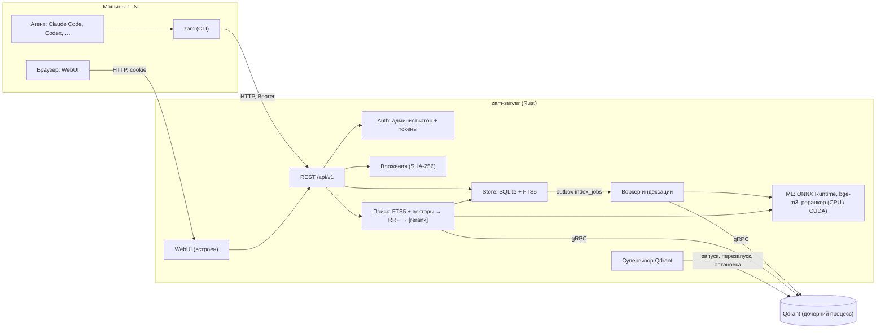

# ZeroAIMemory

[](https://github.com/ogoun/ZeroAIMemory/actions/workflows/ci.yml)

Централизованная человекочитаемая память для AI-агентов. Один самодостаточный сервер в
локальной сети хранит знания в виде дерева Markdown-заметок. Агенты (Claude Code, Codex и
другие) читают и пишут их через API по токену, человек — через встроенный WebUI.

> **Статус: ранняя разработка.** Выпущены этапы M0–M4 (теги `v0.0.1-m0`, `v0.0.2-m1`,
> `v0.0.3-m2`, `v0.0.4-m3`, `v0.0.5-m4`), этап M4.5 «Рабочая память» готов в ветке
> `m4.5-working-memory` (версия `0.0.6-m4.5`, тег — после слияния в `main` и зелёного CI).
> API и формат данных до версии 1.0 могут меняться. Ниже везде отмечено, что уже работает, а
> что только запланировано.

## Содержание

- [Зачем](#зачем)
- [Статус и дорожная карта](#статус-и-дорожная-карта)
- [Возможности](#возможности)
- [Архитектура](#архитектура)
- [Быстрый старт](#быстрый-старт)
- [Использование](#использование)
- [Требования к системе](#требования-к-системе)
- [Разработка](#разработка)
- [Документация](#документация)
- [Лицензия и сторонние компоненты](#лицензия-и-сторонние-компоненты)

## Зачем

В долгой работе над большим проектом агент забывает пройденное: повторяет уже разобранные
ошибки, заново пробует проваленные гипотезы, не знает, что решили в прошлой сессии или на
другой машине. ZeroAIMemory даёт ему общую память на все сессии, машины и проекты
пользователя:

- агент записывает решения, ловушки и результаты экспериментов и находит их потом гибридным
  поиском. Сервер отдаёт компактные карточки с точными ссылками на источник, а агент сам
  дочитывает нужное;
- человек видит всё, что агент «помнит», в виде обычных Markdown-заметок с историей
  ревизий, правит их в WebUI и может откатить любую правку;
- сервис работает без облака и внешних энкодеров: модели эмбеддингов и реранкера
  запускаются внутри сервера на CPU или NVIDIA GPU, генеративной модели на сервере нет.

Главный приёмочный сценарий «CRLF» (ТЗ §1.1). Агент в проекте A разобрал ошибку
`/bin/bash^M: bad interpreter` и записал инсайт с триггером `**/*.sh`. Через неделю в
проекте B на другой машине хук напоминает ему про LF до того, как он создаст `deploy.sh`.
С M4 сценарий работает целиком — и без сети: хук сверяет путь с локальным кэшем триггеров
(e2e-тест `crlf_scenario` в `crates/zam-cli/tests/m4_acceptance.rs`).

## Статус и дорожная карта

Этапы и критерии готовности описаны в [ТЗ §19](docs/specs/2026-10-17-zeroaimemory-tz.md#19-этапы-реализации).

| Этап | Содержание | Состояние |
|---|---|---|
| **M0. Каркас** | конфигурация, `system.db`, базы пользователей, администратор, пользователи, токены, `/health`, WebUI-заглушка, `zam status`, конвейер релиза | выпущен, `v0.0.1-m0` |
| **M1. Заметки** | Markdown-заметки, секции и PATCH, ревизии, корзина, вложения, FTS5, CLI, WebUI с редактором | выпущен, `v0.0.2-m1` |
| **M2. Индекс и ML** | чанкинг, bge-m3 (ONNX, CPU/CUDA), управляемый Qdrant, очередь индексации, L0/L1, гибридный поиск, реранк, деградация, `index/status`, GPU-комплекты | выпущен, `v0.0.3-m2` |
| **M3. Журналы и граф** | совместный доступ к решению, changelog, releases, insights с замещением и триггерами, `axiom`/`theorem`/`hypothesis`, vault, граф и вики-ссылки, сканер секретов, поиск по папкам, нарезка по силе границ, ELK | выпущен, `v0.0.4-m3` |
| **M4. Агенты** | MCP, `zam init`, хуки Claude Code и Codex, кэш триггеров, `/recall`, сессии, `POST /read`, кэш выжимок, страница «Подключение агента»; вход пользователей в WebUI, режим службы | выпущен, `v0.0.5-m4` |
| **M4.5. Рабочая память** | словарь домена, задачи с захватом, вопросы к человеку, ADR и `contradicts`, ссылки на файлы и устарелость, окружение в Vault, журнал сессии, восстановление после сжатия, пакет субагенту, учёт токенов, блок инструкции v3 | готов, `0.0.6-m4.5` (ветка `m4.5-working-memory`, тег — после слияния) |
| M5. Документы | извлечение текста и просмотр DOCX, XLSX, PDF, PPTX | запланирован, `0.0.7-m5` |
| M6. Экономия токенов | бюджеты и формат карточек по замерам, `promote` | запланирован |
| M7. Полировка | экспорт и импорт, `doctor`, бэкап и восстановление, администрирование | запланирован |

Что вошло в M2 (раздел `[0.0.3-m2]` в [CHANGELOG.md](CHANGELOG.md), итог и проверка
критериев — [docs/journal.md](docs/journal.md)): чанкер §8.2, эмбеддер bge-m3 и реранкеры, супервизор
нативного Qdrant, воркер индексации с кэшем эмбеддингов, L0 заметок и папок, гибридный
`/search` с RRF и реранком, режим деградации до FTS, `GET /index/status`, reindex из кэша,
команды `models`, `cuda` и `qdrant`, комплекты cpu и gpu, архивы `zam-models` и `zam-cuda`,
e2e-тесты жизненного цикла Qdrant, страница «Индекс» в WebUI, строка деградации поиска и
значки индексации, `zam search --rerank`. Набор `eval/` и гейт качества — см. «Качество поиска» ниже, замеры §17 — «Производительность»; прототип `qdrant-edge` и решение не переходить на него — [ADR 0001](docs/adr/0001-qdrant-edge.md). Не все цели §17 выполнены — отступления приняты владельцем (ТЗ v1.7, «Known limitations» в CHANGELOG).

Что вошло в M3 (раздел `[0.0.4-m3]` в [CHANGELOG.md](CHANGELOG.md), итог и проверка
критериев — [docs/journal.md](docs/journal.md)): совместный доступ к решению (память — в базе
владельца, разрешения и отзыв — на каждом запросе), журналы Changelog, Releases и Insights
(замещение без потери, отзыв, дедупликация, триггеры), эпистемический статус
`axiom`/`theorem`/`hypothesis` (аксиомы меняет только человек), граф связей с wiki-ссылками и
`expand=graph`, сканер секретов перед индексацией, Vault с шифрованием и аудитом раскрытия,
поиск по точкам папок, нарезка с учётом силы границ, раскладка ELK для Mermaid, WebUI журналов
и доступа, набор eval M3 и e2e приёмки настоящим процессом сервера.

Что вошло в M4 (раздел `[0.0.5-m4]` в [CHANGELOG.md](CHANGELOG.md), итог и проверка
критериев — [docs/journal.md](docs/journal.md)): MCP `/mcp` (10 инструментов) и `zam mcp`, хуки
`zam hook …` для Claude Code и Codex с локальным кэшем триггеров и fail-open, `/recall`
(дайджест старта, подсказки к запросу и к ошибке), сессии и «без повторов», чтение пачкой
`POST /read`, кэш выжимок агентов с инвалидацией по источникам и `promote`, показы и оценки
полезности, `zam init` и страница «Подключение агента» с шаблонами инструкции, раздача `zam`,
вход пользователей в WebUI, режим службы Windows и systemd, eval подсказок и расхода токенов
(`eval/results/2026-10-28-m4-summary.md`), e2e приёмки M4 (CRLF, бюджеты хуков, `stale`,
fail-open, общее решение с отзывом).

Что вошло в M4.5 (раздел `[0.0.6-m4.5]` в [CHANGELOG.md](CHANGELOG.md), спецификация этапа —
[docs/specs/2026-10-28-m4.5-working-memory.md](docs/specs/2026-10-28-m4.5-working-memory.md),
перенесена в ТЗ v1.17; итог и решения — [журнал этапа](docs/plans/2026-10-28-m4.5-working-memory-log.md)):
словарь домена и поиск по псевдонимам, журнал задач и передача работы, вопросы к человеку с
двух сторон, ADR-поля решений и связь `contradicts`, ссылки знаний на файлы с устарелостью по
хэшу, окружение в Vault, журнал событий сессии хуков, пакет восстановления после сжатия
контекста, пакет под задачу субагента, «ошибка → исправление», чтение изменений `since_rev`,
возраст записей, учёт выданных токенов, блок инструкции v3, WebUI «Словарь», «Задачи», «Вопросы»,
eval словаря RU↔EN (`eval/results/2026-10-29-m45-summary.md`) и e2e приёмки M4.5
(`crates/zam-cli/tests/m45_acceptance.rs`).

## Возможности

Работает в выпущенных версиях (M0, M1):

- **Заметки и папки** в пространствах Knowledge, Rules, Human и в пространствах решений
  (проектов). Чтение целиком, по уровню (L0 — сводка, L1 — оглавление) или по секции
  (`Установка > Linux`). Замена с проверкой ревизии: при конфликте приходит 409 с диффом.
  PATCH секций меняет только байты своей секции, переводы строк и BOM сохраняются.
- **История.** Каждая правка — неизменяемая ревизия с автором, машиной и сессией. Есть дифф,
  откат, мягкое удаление в корзину и аудит.
- **Markdown на сервере** (comrak): GFM, сноски, формулы, callout в стиле GitHub и Obsidian,
  вики-ссылки, подсветка кода, Mermaid. HTML проходит санитизацию ammonia.
- **Вложения** до 200 МБ с дедупликацией по SHA-256 и выдачей с Range.
- **Полнотекстовый поиск** FTS5 (слова и trigram для идентификаторов) с бюджетом токенов,
  режимами `brief`/`chunks`/`notes` и выводом в JSON или Markdown-карточками.
- **Доступ.** Bearer-токены `rw`/`ro` для агентов, вход администратора и пользователей в WebUI (пароль пользователю задаёт администратор, при первом входе — смена). Пространство
  Human по токену недоступно, Rules агент только читает (если не включено `rules.agent_write`).
- **WebUI** (Svelte 5): дерево, просмотр документа с медиа, редактор с предпросмотром, история,
  поиск Ctrl+K, пользователи и токены.
- **CLI `zam`** без рантайма tokio: холодный старт около 6 мс.

Добавлено в M2 (`v0.0.3-m2`):

- **Векторный индекс.** Модель bge-m3 даёт dense- и sparse-векторы (int8 на CPU, fp16 на
  CUDA). Индексирует воркер в фоне, а запись заметки индексацию не ждёт. Векторы кэшируются в
  SQLite, поэтому индекс Qdrant пересобирается без инференса.
- **Гибридный поиск.** Каналы vector, bm25 и trigram сливаются через weighted RRF с затуханием
  по свежести и лимитом карточек на узел. Опционально включается серверный реранк
  cross-encoder (`"rerank": "on"`).
- **Деградация вместо отказа.** Если нет модели, ONNX Runtime или Qdrant, поиск идёт по FTS и
  отвечает с `degraded: true` и кодом причины. Запись при этом работает. WebUI пишет причину
  над результатами Ctrl+K, CLI — в stderr.
- **Состояние индекса в WebUI** (раздел «Индекс», `#/admin/index`): модель, устройство,
  Qdrant, очередь, неудавшиеся задания, повреждённые и исключённые из пересборки базы,
  причина выключения векторного поиска с командой для администратора, переиндексация из кэша
  или полная. У результатов поиска — метки каналов `vector`/`fts`, у заметок в дереве и в
  документе — значки «в очереди» и «ошибка индексации».
- **Управляемый Qdrant.** Нативный бинарник из комплекта, без Docker. Сервер сам его
  запускает, перезапускает при падении и завершает вместе с собой.

Добавлено в M3 (`v0.0.4-m3`):

- **Совместный доступ к решению.** Первый зарегистрировавший решение — владелец; другие
  пользователи получают доступ `rw` или `ro` после одобрения и видят в базе владельца только
  пространство решения. Отзыв действует со следующего запроса.
- **Журналы.** Changelog, Releases со сравнением и Insights: замещение старого вывода новым без
  потери истории, отзыв с причиной, дедупликация, триггеры вспоминания. Поиск по умолчанию
  показывает только действующие записи, `include_history` — всю историю.
- **Надёжность записей.** `axiom` — установлено человеком: в WebUI или агентом по прямому
  указанию пользователя (агенту смена статуса — только с причиной); `theorem` агент ставит только
  с доказательством, `hypothesis` — по умолчанию; надёжное поднимается в поиске выше гипотезы.
  Правка записи журнала — с ревизией (`If-Match`): параллельная правка не затирает чужую.
- **Граф.** Связи из wiki-ссылок, Markdown-ссылок и `relations:`, явные рёбра, обратные
  ссылки, `expand=graph` в поиске.
- **Секреты.** Сканер маскирует ключи и пароли до индексации; Vault хранит их зашифрованными
  (XChaCha20-Poly1305, мастер-ключ сервера), каждое раскрытие — в аудите.
- **WebUI**: журналы, Vault, связи, страница «Решения» и настройки, диаграммы Mermaid с
  раскладкой ELK.

Добавлено в M4 (`v0.0.5-m4`):

- **MCP.** `/mcp` по streamable HTTP и stdio-прокси `zam mcp`: `memory_search`, `memory_read`,
  `memory_cache_put`, `memory_tree`, `memory_write`, `memory_log`, `memory_update_entry`,
  `memory_link`, `memory_recall`, `memory_vault` — те же права и атрибуция, что у REST.
- **Хуки агента.** `zam hook session-start|prompt|pre-tool|post-tool|checkpoint` для Claude Code и
  Codex: дайджест на старте сессии, подсказки к запросу и к ошибке инструмента, локальная
  подсказка перед записью файла или командой (без сети, по кэшу триггеров), напоминание
  записать итоги. Хук никогда не блокирует агента: при любой ошибке — тишина и код 0.
- **Экономия токенов.** Протокол «кэш → карточки → чтение пачкой → `cache_put`»: выжимка агента
  с источниками выдаётся первой в поиске и устаревает (`stale`) при изменении источника; в общем
  решении выжимки общие, с автором.
- **Подключение агента.** `zam init` и страница WebUI «Подключение агента» пишут блок
  инструкции, `solution.toml`, хуки и `.mcp.json`; токен — только в `~/.zeroaimemory/config.toml`
  и `ZAM_TOKEN`. Клиент `zam` раздаётся сервером (`/downloads/zam/…`).
- **Пользователи и служба.** Вход пользователей в WebUI со своими токенами и решениями; режим
  службы Windows (SCM) и systemd (`zam-server service install|start|stop|status`).

Добавлено в ветке M4.5, войдёт в следующий релиз (`0.0.6-m4.5`):

- **Словарь домена.** Термины с определением и псевдонимами (`zam log term`, `zam glossary`):
  поиск по псевдониму находит заметку с каноническим словом (канал `alias`, «summary» →
  «выжимка»), хук подсказывает определение термина из промпта, запись с псевдонимом вместо
  имени получает предупреждение `term_alias`.
- **Задачи и передача работы.** `zam task new|claim|status`: захват сессией агента, `next_step`,
  длительность; после сжатия контекста или в новой сессии агент видит задачи в работе первыми.
- **Вопросы к человеку.** Агент задаёт вопрос (`zam question ask`, MCP), человек отвечает в
  WebUI одним кликом или в чате — ответ становится решением `axiom` и приходит в следующий
  дайджест.
- **Решения и противоречия.** ADR-поля решения (`data.decision`), предупреждение о близкой
  аксиоме, связь `contradicts`: возражение не стоит в выдаче выше надёжной записи.
- **Знание о коде.** Записи ссылаются на файлы (`--ref`, `refs:` во frontmatter) с хэшем;
  правка файла помечает знание «возможно устарело» (хук или `zam refs check`), а при чтении
  файла хук без сети подсказывает, что о нём есть в памяти.
- **Окружение в Vault.** Хосты и стенды (`zam vault add --type host`): открытые поля ищутся
  `vault?q=` и видны в дайджесте, секрет — только раскрытием с аудитом.
- **Рабочая память хуков.** Локальный журнал событий сессии (только метаданные), пакет
  восстановления после `/compact`, пакет под задачу субагента (`SubagentStart`, `brief`),
  напоминание записать «ошибка → исправление», учёт выданных токенов; агентам без хуков — те же
  функции через MCP (`memory_recall event=recovery|brief`) и блок инструкции v3.

## Архитектура



Принципы (ТЗ §4.1):

- **Источник истины — SQLite и файлы вложений.** Qdrant — производный индекс, он
  пересобирается из таблицы `embeddings` без инференса.
- **Ядро — REST.** CLI, WebUI и MCP (`/mcp`, с M4) работают через него.
- **История только дописывается.** Ревизии не перезаписываются, удаление мягкое.
- **Самодостаточность.** Модели скачиваются по закреплённым ревизиям и SHA-256 и
  исполняются в процессе сервера. ONNX Runtime подгружается динамически, поэтому без него
  сервер стартует в режиме FTS-only.

Каталог данных (`data_dir`, ТЗ §6.1):

```
<data_dir>/
  system.db                      # пользователи, токены, сессии WebUI, аудит, настройки, реестр решений
  users/<user_id>.db             # вся память пользователя: узлы, ревизии, чанки, FTS, эмбеддинги, очередь
  blobs/<user_id>/<aa>/<sha256>  # вложения
  models/<id>/                   # ONNX-модели (ml.models_dir), LICENSE и model.toml в каждой
  qdrant/                        # рабочий каталог управляемого Qdrant: config/zam.yaml, storage/, qdrant.pid
  previews/  backups/          # зарезервированы: превью документов (M5), бэкапы (M7)
  logs/
```

Qdrant в режиме `managed` (по умолчанию) слушает только `127.0.0.1` и получает новый
API-ключ при каждом старте. Он привязан к процессу сервера: на Windows через Job Object, на
Linux через `PR_SET_PDEATHSIG`. При падении сервер перезапускает его с задержкой от 1 до
60 с, после 5 падений за 10 минут переходит в режим деградации. Режим `external` подключает
уже работающий Qdrant. Подробности — в ТЗ §4.3 и разделе «Qdrant» инструкции по установке.

## Быстрый старт

Полная инструкция — [deploy/README-install.md](deploy/README-install.md). Здесь только
основные шаги.

**1. Скачайте комплект** со страницы
[Releases](https://github.com/ogoun/ZeroAIMemory/releases). Контрольные суммы лежат в
`SHA256SUMS`.

| Архив | Назначение |
|---|---|
| `zam-server-<ver>-<os>-x64-cpu` | сервер с ONNX Runtime для CPU, Qdrant, WebUI и клиент `zam` |
| `zam-server-<ver>-<os>-x64-gpu` | то же с CUDA EP. Библиотек NVIDIA в нём нет, без GPU работает на CPU |
| `zam-cuda-<ver>-<os>-x64` | библиотеки CUDA 13 и cuDNN 9 для GPU-комплекта, для машин без интернета |
| `zam-models-<ver>-<id>.zip` | одна ONNX-модель (`bge-m3-int8`, `bge-m3-fp16`, `bge-reranker-v2-m3`), для машин без интернета |
| `zam-<ver>-<os>-x64` | только CLI `zam` |

`<os>` — `windows` (zip) или `linux` (tar.gz). В выпущенных `v0.0.1-m0` и `v0.0.2-m1`
есть только комплекты `cpu` и архивы `zam`, а поиск в них полнотекстовый. Комплекты `gpu`,
архивы `zam-cuda` и `zam-models` и векторный поиск появятся в релизе этапа M2.

**2. Задайте пароль администратора и запустите сервер.**

```
zam-server hash-password                 # пароль вводится по приглашению, вывод вставьте в [admin] password_hash
cp config.example.toml config.toml       # Windows: copy config.example.toml config.toml
zam-server serve --config config.toml
```

Для пробного запуска хватит переменной `ZAM_ADMIN_PASSWORD`. При первом старте сервер один
раз печатает в stderr первый токен администратора (`ZeroAIMemoryToken=…`). Сохраните его.

**3. Поставьте модели и библиотеки CUDA** (только начиная с M2). Без моделей сервер работает
в режиме FTS-only.

```
zam-server models fetch --config config.toml            # модель эмбеддингов для своего устройства
zam-server models fetch --config config.toml --reranker # и реранкер
zam-server cuda fetch --config config.toml              # только GPU-комплект: CUDA 13 и cuDNN 9
```

Без интернета распакуйте архивы `zam-models-*` в `<data_dir>/models`, а `zam-cuda-*` — в
каталог `zam-server`.

**4. Войдите в WebUI** по адресу `http://<хост>:7700/` с логином `admin` (`[admin] login`).
В разделе пользователей выпустите токен: `rw` для агента, `ro` только для чтения. Токен
показывается один раз.

**5. Подключите агента** (с M4). Проще всего — страница WebUI «Подключение агента»
(`#/agent-setup`): она выпускает токен и даёт команды установки `zam` и однострочник `zam init`.
В корне проекта:

```
zam init --url http://<хост>:7700 --token <токен> --agent both
zam status
```

`zam init` создаёт `.zeroaimemory/solution.toml` (GUID решения: каталоги с одинаковым GUID на
разных машинах делят одно решение), вставляет блок инструкции v2 в CLAUDE.md и/или AGENTS.md,
сливает хуки в `.claude/settings.json` и `.codex/hooks.json` и сервер MCP в `.mcp.json`. Токена
в файлах проекта нет: он хранится в `~/.zeroaimemory/config.toml`, а MCP берёт его из
переменной `ZAM_TOKEN`. Подробно (Codex, ручная настройка, служба) —
[deploy/README-install.md](deploy/README-install.md), раздел «Подключение агента (`zam init`)».

## Использование

### CLI `zam`

Адрес и токен `zam` ищет по порядку: флаги `--url`/`--token`, переменные `ZAM_URL`/`ZAM_TOKEN`,
блок в `CLAUDE.local.md`, `CLAUDE.md` или `AGENTS.md` от текущего каталога вверх, затем
`~/.zeroaimemory/config.toml`. У всех команд есть `--json`.

Цель команды — `[пространство:]путь` или id узла. Пространство: `knowledge`, `rules`, `human`,
`solution` или GUID решения. Без префикса берётся решение из `.zeroaimemory/solution.toml`,
а если файла нет — `knowledge`.

| Команда | Что делает |
|---|---|
| `zam status` | проверка сервера, токена, пользователя и `solution.toml` |
| `zam tree [цель] [--depth 1..5]` | дерево с краткими сводками L0 |
| `zam read <цель>… [--tier L0\|L1\|L2] [--section "A > B"] [--rev N]` | чтение Markdown как он сохранён; `--batch`, `--max-tokens N`, `--budget N`, `--if-rev N`, `--since-rev N` (дифф с ревизии, M4.5) — пачкой через `POST /read` с бюджетом токенов |
| `zam write <цель> [--file f.md] [-m сообщение] [--base-rev N] [--l0 текст]` | создать или заменить заметку (без `--file` текст читается из stdin) |
| `zam history <цель> [--diff A..B \| --revert N]` | ревизии, дифф, откат |
| `zam search <запрос> [--all] [--mode brief\|chunks\|notes] [--top-k N] [--rerank]` | поиск, по умолчанию Markdown-карточки; `--rerank` — серверный реранк |
| `zam attach <цель> <файл>` | загрузить вложение и напечатать ссылку `_attachments/…` |
| `zam cache put --query Q --sources ID[#секция][@rev],… [--promote note:<путь>\|insight:<вид>] < выжимка.md` | сохранить выжимку с источниками (печатает `c_<id>`); `zam cache list\|show\|rm` — список, карточка с изменившимися источниками, удаление |

```
echo "# Bash-скрипты" | zam write "knowledge:Инструменты/Bash" -m "первая версия"
zam search "перевод строки в sh" --mode chunks
zam read "knowledge:Инструменты/Bash" --section "Установка > Linux"
```

Если векторный поиск выключен (нет моделей, Qdrant недоступен), `zam search` отвечает
результатами полнотекстового поиска: в Markdown остаётся строка сервера `> degraded: <код> — <причина>`,
а в stderr печатается причина по-русски. Предупреждения ответа (например, «реранкер не
установлен» при `--rerank`) тоже идут в stderr, в Markdown — строками `> warning:`.

Коды выхода: 0 — успех, 1 — конфигурация, 2 — сервер недоступен, 3 — токен, 4 — конфликт
ревизий (дифф в stderr), 5 — не найдено, 6 — неверный ввод. Команды журналов, Vault, связей и
доступа (`zam log`, `insight`, `release`, `vault`, `link`, `links`, `solution access`) есть с M3,
команды агента (`zam init`, `guide`, `mcp`, `hook …`, `triggers sync`, `cache`,
`solution rename`) — с M4, рабочей памяти (`zam log term`, `glossary`, `task`, `question`,
`refs check|verify`, `links file:`, `vault add`, `hook subagent-start`) — с M4.5; см.
[deploy/README-install.md](deploy/README-install.md). Хуки
(`zam hook …`) всегда выходят с кодом 0.

### REST API

Все эндпоинты лежат под `/api/v1` и принимают `Authorization: Bearer <токен>`. Ошибки
приходят в формате RFC 9457. Полный список — в
[ТЗ §12](docs/specs/2026-10-17-zeroaimemory-tz.md#12-rest-api-apiv1). Уже реализованы
группы Auth, Админ (пользователи, токены, аудит, reindex), Пространства и решения, Дерево,
Узлы, Ревизии, Рендер, Вложения, `POST /search`, `GET /index/status`, а с M3 — решения и
доступ, журналы, insights и триггеры, vault и граф, а с M4 — сессии, `POST /read`, кэш выжимок,
`/recall`, `/agent-setup`, `/downloads`, вход пользователей и `/mcp`, с M4.5 — словарь,
задачи (`claim`/`release`), ответы на вопросы, ссылки на файлы (`/files/changed`,
`/files/verified`, `/file-refs`), `/recall` `recovery` и `brief`. Экспорт и импорт пока не
сделаны.

```
curl -s -X POST http://<хост>:7700/api/v1/search \
  -H "Authorization: Bearer <токен>" -H "Content-Type: application/json" \
  -d '{"query": "bad interpreter", "mode": "brief", "format": "md", "budget_tokens": 800}'
```

### Администрирование `zam-server`

| Команда | Что делает |
|---|---|
| `serve [--config] [--bind] [--data-dir]` | запуск сервера |
| `hash-password` | argon2id-хэш пароля администратора |
| `migrate` | открыть все базы с миграциями и выйти |
| `models fetch\|status` | модели по `deploy/models.toml`, с проверкой SHA-256 (M2) |
| `cuda fetch` | библиотеки NVIDIA для GPU-комплекта (M2) |
| `qdrant fetch\|status\|reset` | бинарник, состояние и сброс хранилища управляемого Qdrant (M2) |
| `reindex [--user] [--space] [--full]` | пересборка векторного индекса на остановленном сервере (M2) |
| `service install\|uninstall\|start\|stop\|status\|run` | режим службы: Windows SCM или systemd (M4) |

### MCP

С M4: `/mcp` по streamable HTTP без сессий, `Authorization: Bearer`, 10 инструментов
(`memory_search`, `memory_read`, `memory_cache_put`, `memory_tree`, `memory_write`, `memory_log`,
`memory_update_entry`, `memory_link`, `memory_recall`, `memory_vault`; ТЗ §13.1). Ответы —
компактный Markdown с последней строкой `~N tok`. Для агентов без HTTP-транспорта MCP — `zam mcp`
(stdio). Фрагмент `.mcp.json` пишет `zam init` или даёт «Подключение агента».

## Требования к системе

- **ОС:** Windows x64 или Linux x64. Linux-сервер собран на Ubuntu 22.04 и требует glibc
  2.35 или новее. `zam` и Qdrant для Linux статические (musl). Linux arm64 и macOS не
  поддерживаются.
- **Windows:** VC++ Redistributable ставить не нужно. Нужные библиотеки MSVC runtime лежат в
  комплекте рядом с исполняемыми файлами.
- **CPU-профиль:** модель `bge-m3-int8` занимает около 0,6 ГБ на диске; RSS сервера с ней —
  около 1,4 ГиБ (две сессии ORT — индексации и запросов — держат по копии весов; цель ТЗ §17
  — 1,5 ГБ; после поиска 1439 МиБ = 1,509 ГБ, на 0,6 % выше), с реранкером jina — ещё около 0,9 ГиБ при двух сессиях (`ml.rerank_sessions`).
  Qdrant — отдельный процесс: на 10 тыс. заметок (34 тыс. точек) — около 340 МиБ.
- **GPU-профиль:** только NVIDIA и CUDA (DirectML и другие исполнители не поддерживаются).
  Нужен драйвер с поддержкой CUDA 13, ветка R580 или новее. CUDA Toolkit ставить не нужно.
  Библиотеки ставит `zam-server cuda fetch` (около 1,9 ГБ архивов на Windows и 2,2 ГБ на
  Linux) или архив `zam-cuda`. Без доступной CUDA GPU-комплект работает на CPU.
- **Диск:** на Windows полный путь каталога данных не длиннее 190 символов.
- **Сеть:** сервер слушает `0.0.0.0:7700`, Qdrant — `127.0.0.1:6333/6334`. TLS нет: для
  внешнего доступа используйте обратный прокси, пример для Traefik есть в
  [инструкции](deploy/README-install.md).

## Разработка

### Окружение

Тулчейн Rust закреплён в `rust-toolchain.toml` (1.99.1, edition 2024). Он ставится не в
систему, а в каталог проекта `.toolchain/`. Перед работой подключите окружение — скрипт
выставит `RUSTUP_HOME`, `CARGO_HOME`, `PATH`, перенаправит временные файлы и кэш npm в
`.tmp/`:

```
. scripts/dev-env.ps1        # PowerShell
source scripts/dev-env.sh    # bash
```

Временные файлы создавайте только в `target/` и `.tmp/`, оба каталога в `.gitignore`. Для
WebUI нужен Node.js 22. Для упаковки на Windows нужна Visual Studio с VC Tools: каталог MSVC
runtime ищется через vswhere или задаётся в `ZAM_VC_CRT_DIR`.

### Сборка и тесты

```
cargo xtask fetch-deps --platform windows-x64      # Qdrant, ONNX Runtime CPU и GPU, pdfium → target/deps/
cargo xtask fetch-models --test                    # тестовая модель MiniLM → target/models/
cargo test --workspace
cargo build --release -p zam-server -p zam-cli
```

- Тесты ML и индекса пропускаются, если нет ONNX Runtime или модели. С `ZAM_REQUIRE_ML=1`
  (так в CI) они вместо этого падают.
- Интеграционные тесты запускают настоящий Qdrant из `target/deps`, Docker не нужен.
  `ZAM_TEST_QDRANT_MAX` ограничивает число одновременно запущенных экземпляров в одном
  тестовом бинарнике (по умолчанию 4). На HDD это убирает падения тестов от взаимной нагрузки.
- CI дополнительно проверяет `cargo fmt --check` и `cargo clippy --workspace --all-targets -- -D warnings`.

### Команды xtask

| Команда | Назначение |
|---|---|
| `fetch-deps --platform windows-x64\|linux-x64 [--flavor cpu\|gpu] [--print-hashes]` | зависимости поставки по манифестам `deploy/*.toml` с проверкой SHA-256 |
| `fetch-models [--test] [--id ID]… [--accept-nc-license]` | модели из `deploy/models.toml` в `target/models/<id>/` |
| `package --platform … --flavor cpu\|gpu --version X.Y.Z [--with-models] [--cuda] [--no-kit]` | архивы поставки в `target/dist/` и `SHA256SUMS` |
| `smoke --archive … [--cuda-archive …] [--expect-device cpu\|cuda]` | smoke-тест комплекта: запуск, API, `zam`, Qdrant, векторный поиск на тестовой модели |
| `smoke-cuda --archive …` | проверка архива `zam-cuda`: штампы, состав, формат библиотек, лицензии |
| `changelog-section <версия>` | раздел версии из `CHANGELOG.md` для текста релиза |
| `eval [--device cpu\|cuda] [--mode fts\|hybrid\|hybrid+rerank]… [--quality-gate] [--grid FILE] [--check]` | качество поиска на наборе `eval/`: recall@5, MRR@10, nDCG@10, гейт int8 против fp32, подбор весов и чанкинга |
| `bench --profile cpu\|gpu [--notes N] [--phase …]… [--keep] [--reuse]` | замеры целей §17 ТЗ на корпусе eval с копиями до 10 000 заметок: поиск при пустой и полной очереди, FTS-only, реранк, индексация, запись, reindex, RSS, старт, падение Qdrant |

```
cargo xtask package --platform windows-x64 --flavor cpu --version 0.0.0-dev   # → target/dist/
cargo xtask smoke --archive target/dist/zam-server-0.0.0-dev-windows-x64-cpu.zip
```

`package --flavor gpu` собирает GPU-комплект, `--cuda` — архив `zam-cuda` (проверка —
`cargo xtask smoke-cuda --archive …`), `--with-models` — архивы `zam-models` (сначала
`cargo xtask fetch-models`), `--no-kit` — только эти архивы, без комплектов. Smoke
GPU-комплекта на машине с NVIDIA:
`--cuda-archive target/dist/zam-cuda-….zip --expect-device cuda`.

### Качество поиска (eval)

Набор `eval/` (ТЗ §18.2): 160 заметок на русском и английском, 197 запросов пяти видов, из них
23 % — перефразы без единого общего слова с ответом. Прогон обязателен при изменении
чанкинга, весов или моделей; результаты — в `eval/results/`, как запускать и что значат
метрики — в [eval/README.md](eval/README.md).

```
cargo xtask eval --mode fts                                  # без моделей
cargo xtask eval --mode hybrid --mode hybrid+rerank          # bge-m3 int8 на CPU
cargo xtask eval --device cuda --mode hybrid --mode hybrid+rerank
cargo xtask eval --quality-gate                              # int8 против fp32 BAAI
```

Последний прогон (2026-10-20, nDCG@10 по всем запросам): FTS-only 0,69; hybrid int8 CPU
0,75, с реранком jina 0,83; hybrid fp16 CUDA 0,75, с реранком bge-reranker 0,83. Веса
подобраны на том же наборе, так что оценка после подбора завышена. Ухудшения поиска int8
относительно fp32 не обнаружено (95 % интервал Δ nDCG@10 −0,007…+0,012), но порог
косинуса dense 0,99 гейта int8 не проходит (0,978) — решение и альтернативы в журнале
[docs/plans/2026-10-19-m2-index-ml-log.md](docs/plans/2026-10-19-m2-index-ml-log.md).

### Производительность (§17)

`cargo xtask bench --profile cpu` и `--profile gpu` (данные — в `target/bench/`, удаляются после
прогона; итог — `eval/results/<дата>-bench-<профиль>.md`). Последние прогоны (2026-10-20, код
`d1d2521`, Ryzen 9 5900X, RTX 3090, данные на HDD, 10 тыс. заметок, тёплый кэш ОС, p95):
поиск `chunks` без реранка — CPU 71 мс (92 при полной очереди индексации), GPU 37 (52); с
реранком — CPU 1,45 с, GPU 114 мс; FTS-only — 30–32 мс; индексация — CPU 690–770 токенов/с
(≈ 1,7–1,9 чанка по 400 токенов), GPU 7141 токен/с на корпусе eval и 4323 на 10 тыс. заметок
(упор в HDD); запись до векторного индекса — CPU 1,98 с, GPU 0,46 с; `reindex` из кэша —
2250–2520 точек/с; старт до готовности Qdrant — 1,1–2,0 с.

Решения владельца по итогам замеров (2026-10-20, ТЗ v1.7 §17): цель индексации на GPU —
≥ 3000 токенов/с (RTX 3090, HDD); RSS с моделью на CPU — 1,5 ГБ (две сессии); память
реранкера jina — по факту `ml.rerank_sessions`; цель 5 с до готовности Qdrant — для штатного
перезапуска, а первый старт после массовой индексации (CPU 9,6 с, GPU 5,4 с — повтор WAL
Qdrant) исследуется отдельно; FTS-only 30–32 мс (цель 20), поиск на GPU при полной очереди
52 мс (цель 50) и индексация на CPU 690–770 токенов/с (цель — 3 чанка по 400 токенов) приняты
как есть. Открыто: RSS на GPU (808–1248 МиБ при 0,6 ГБ), RSS без моделей на 10 тыс. заметок
(54 МиБ при 50 МБ). Таблица и причины — в [docs/journal.md](docs/journal.md).

### WebUI

Исходники лежат в `web/` (Svelte 5, Vite, TypeScript). Собранный `web/dist` встраивается в
бинарник `zam-server` при сборке. Если `web/dist` нет, сервер собирается с заглушкой.

```
cd web
npm ci
npm run check        # svelte-check
npm run build        # → web/dist
npm run size         # предел начального бандла (size-limit)
npm run e2e          # Playwright с Microsoft Edge; нужен target/release/zam-server
```

После первого `npm run build` пересоберите сервер с `ZAM_WEB_REBUILD=1`, иначе build-скрипт
не заметит появления `web/dist`.

### Структура репозитория

```
crates/
  zam-core/        # идентификаторы (UUIDv7, Crockford base32), токены
  zam-store/       # SQLite: миграции, узлы, ревизии, FTS5, вложения, эмбеддинги, очередь индексации
  zam-markdown/    # comrak: разбор с позициями, секции, PATCH-splice, рендер HTML, чанкер, предложения, L0/L1
  zam-ml/          # ONNX Runtime: устройство CPU/CUDA, токенизатор, эмбеддер bge-m3, реранкер
  zam-index/       # VectorIndex и адаптер Qdrant, супервизор процесса Qdrant, воркер, reindex
  zam-search/      # гибридное слияние RRF, поправки, упаковка в бюджет токенов
  zam-fetch/       # загрузка по манифестам: SHA-256, распаковка, модели, библиотеки CUDA
  zam-server/      # axum: REST API, auth, WebUI, команды сервера
  zam-cli/         # клиент zam
web/               # WebUI (Svelte 5 + Vite), e2e на Playwright
xtask/             # cargo xtask: fetch-deps, fetch-models, package, smoke, smoke-cuda, eval
eval/              # набор eval: корпус, запросы, сетки, результаты (eval/README.md)
tools/             # вспомогательные скрипты (квантование bge-m3 для гейта качества)
deploy/            # манифесты зависимостей и моделей, пример конфига, systemd, лицензии, README-install.md
scripts/           # dev-env.ps1, dev-env.sh
docs/              # ТЗ, планы, исследования, журнал работ
.github/workflows/ # ci, package, cuda, release
```

Целевая структура описана в ТЗ §20. Крейт `zam-docs` и каталоги `benches/`,
`docs/adr/` появятся на следующих задачах и этапах.

### CI и релиз

- `ci.yml` — каждый push и PR: web (check, build, size-limit), fmt, clippy и тесты на
  Windows и Linux, комплекты cpu и gpu обеих платформ со smoke (`package.yml`).
- `cuda.yml` — вручную и при изменении `deploy/cuda.toml` или кода загрузки и упаковки
  CUDA: загрузка библиотек NVIDIA и проверка архива `zam-cuda` на обеих ОС.
- `release.yml` — тег `vX.Y.Z`: тесты, все комплекты и архивы (`zam-cuda`, `zam-models`),
  проверка состава и предела 2 ГиБ на файл, черновик GitHub Release с текстом из
  `CHANGELOG.md`. Версия в теге должна совпадать с версией workspace.
- **Пробный прогон релиза без публикации** — push в ветку `release-dry-run` (например,
  `git push origin HEAD:release-dry-run`) или ручной запуск `release.yml` (Actions → Release →
  Run workflow, с любого ref, в том числе с тега). Выполняется всё то же, что на теге, с
  версией `0.0.0-dry`: сборка, `zam-cuda` и `zam-models`, smoke, проверка состава, размеров и
  `SHA256SUMS`. Задача `publish` пропускается, архивы остаются артефактами прогона. Его стоит
  запускать перед каждым тегом, если менялись упаковка, манифесты `deploy/` или workflow.

Изменения записываются в [CHANGELOG.md](CHANGELOG.md) (Keep a Changelog), ход работ — в
[docs/journal.md](docs/journal.md).

## Документация

| Документ | Что там |
|---|---|
| [docs/specs/2026-10-17-zeroaimemory-tz.md](docs/specs/2026-10-17-zeroaimemory-tz.md) | техническое задание (v1.3): цели, архитектура, модель данных, поиск, API, этапы |
| [deploy/README-install.md](deploy/README-install.md) | установка и эксплуатация: первый запуск, CLI, Qdrant, модели, GPU, reindex, прокси, обновление |
| [docs/plans/](docs/plans/) | планы реализации этапов (M0, M1, M2) и журналы их выполнения |
| [docs/research/](docs/research/) | исследования: аналоги, MD-движки, стек, аудит библиотек, индекс и ML |
| [docs/journal.md](docs/journal.md) | журнал работ: решения, прогоны, замеры |
| [CHANGELOG.md](CHANGELOG.md) | изменения по версиям |

## Лицензия и сторонние компоненты

Код проекта распространяется по лицензии [MIT](LICENSE).

Комплекты включают сторонние компоненты под их собственными лицензиями. Тексты лежат в
[deploy/licenses/](deploy/licenses/) и попадают в каталог `LICENSES/` комплекта вместе со
сводкой Rust- и npm-зависимостей (cargo-about, license-checker):

- Qdrant — Apache-2.0; ONNX Runtime — MIT; pdfium — BSD/Apache.
- WebUI: бандл содержит `elkjs` (раскладка ELK для диаграмм Mermaid с `layout: elk`) под
  **EPL-2.0** — слабым копилефтом на уровне файлов, не заражающим остальной код под MIT.
  Это единственное исключение из списка допустимых лицензий бандла (решение владельца
  2026-10-21; проверка по имени пакета и лицензии — `web/build/license-policy.ts`). Код ELK
  лежит в отдельном ленивом чанке и загружается только при первой такой диаграмме. Текст
  EPL-2.0 и ссылка на исходники (<https://github.com/kieler/elkjs>, версия указана там же)
  входят в `THIRD-PARTY-NOTICES.txt` бандла WebUI.
- MSVC runtime в комплекте Windows распространяется на условиях Microsoft
  (`MSVC-RUNTIME-NOTICE.txt`).
- Библиотеки NVIDIA CUDA и cuDNN входят только в архив `zam-cuda` (или ставятся
  `zam-server cuda fetch`) и распространяются по CUDA Toolkit EULA и лицензии cuDNN
  ([deploy/licenses/nvidia/](deploy/licenses/nvidia/)).
- Модели: `bge-m3` — MIT, `bge-reranker-v2-m3` — Apache-2.0. В каталог каждой
  скачанной модели кладётся `LICENSE` со ссылками на лицензию и карточку модели.
  **`jina-reranker-v2` распространяется по CC-BY-NC-4.0, то есть только для некоммерческого
  использования.** Поэтому он не входит в архивы `zam-models` и скачивается только с явным
  флагом `--accept-nc-license`. Для коммерческого использования на CPU укажите
  `ml.rerank_model_cpu = "bge-reranker-v2-m3"`.
