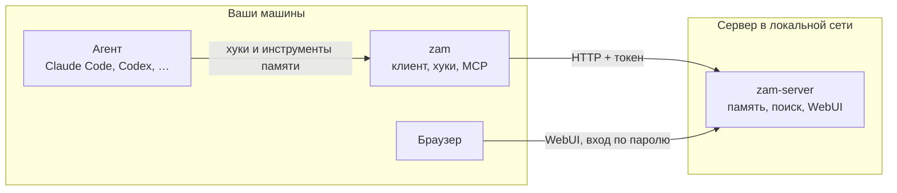

# ZeroAIMemory

[](https://github.com/ogoun/ZeroAIMemory/actions/workflows/ci.yml)

**Общая долговременная память для AI-агентов, которая работает у вас в сети.** Один сервер
хранит то, что агенты узнали о ваших проектах: решения, ловушки, задачи, историю работ, карту
кода. Агенты (Claude Code, Codex и другие) пользуются этой памятью сами, а вы видите и правите её
в браузере.

> **Статус: ранняя разработка.** Текущая версия — `0.0.18-m7.5` (2026-11-28). До версии 1.0 API
> и формат данных могут меняться. Что вошло в каждую версию — [CHANGELOG](CHANGELOG.md), этапы и
> планы — [docs/status.md](docs/status.md).

## Содержание

- [Что это и зачем](#что-это-и-зачем)
- [Как это устроено](#как-это-устроено)
- [Основные понятия](#основные-понятия): пользователь и токен, решение, где проект находит
  свою память, что лежит в памяти
- [Установка сервера](#установка-сервера)
- [Сценарий 1. Новый проект](#сценарий-1-новый-проект)
- [Сценарий 2. Существующий проект с переносом данных](#сценарий-2-существующий-проект-с-переносом-данных)
- [Что видит человек: WebUI](#что-видит-человек-webui)
- [Команды zam](#команды-zam)
- [Команды zam-server](#команды-zam-server)
- [Требования к системе](#требования-к-системе)
- [Документация](#документация)
- [Лицензия и сторонние компоненты](#лицензия-и-сторонние-компоненты)

## Что это и зачем

AI-агент не помнит прошлых сессий. В долгой работе над проектом это обходится дорого: агент
заново разбирает уже решённые ошибки, пробует отвергнутые подходы, не знает, о чём вы
договорились вчера или на другой машине. Заметки в `CLAUDE.md` и собственная память агента
помогают, но они разрознены по машинам и проектам, растут без порядка и целиком попадают в
контекст, расходуя токены.

ZeroAIMemory решает это одним сервером в локальной сети:

- **Агент помнит между сессиями, машинами и проектами.** Он записывает решения, найденные
  ловушки, результаты экспериментов, задачи, а в новой сессии получает их обратно — без
  ваших напоминаний.
- **Память приходит вовремя.** Перед правкой файла агент видит ловушки, связанные с этим
  файлом; при ошибке команды — известное решение; к вашему запросу — подходящие записи. Это
  делают хуки агента, без лишних действий с вашей стороны.
- **Экономно.** Вместо загрузки всего подряд агент получает короткие карточки с точными
  ссылками и дочитывает только нужное.
- **Вы видите и решаете.** Вся память — обычные Markdown-заметки и записи журналов с историей
  правок. В WebUI вы читаете, правите, откатываете, отвечаете на вопросы агента, принимаете или
  отклоняете его предложения. Правила для всех проектов и аксиомы утверждает только человек.
- **Своё, без облака.** Сервер самодостаточен: поиск и модели эмбеддингов работают внутри него
  на CPU или NVIDIA GPU, интернет и Docker не нужны. Генеративной модели на сервере нет;
  подключить свою (в том числе локальную) можно для фоновых работ — по желанию.
- **Для одного человека и для команды.** У каждого пользователя своя память; проект можно
  открыть коллегам на чтение или запись.

**Пример.** В одном проекте агент разобрал ошибку `/bin/bash^M: bad interpreter` — скрипт был
сохранён с переводами строк Windows — и записал ловушку «скрипты `*.sh` — только LF». Через
неделю в другом проекте, на другой машине, агент собирается создать `deploy.sh`, и хук
напоминает ему про LF до того, как файл появится. Сеть для этого не нужна: правила-триггеры
хранятся у клиента.

## Как это устроено



- **`zam-server`** — сервер памяти: хранит данные (SQLite, файлы вложений, векторный индекс
  Qdrant как вспомогательный процесс), ищет, раздаёт WebUI и клиент `zam`.
- **`zam`** — клиент на каждой машине. Это и командная строка для человека, и мост для агента:
  через `zam` работают хуки агента и инструменты памяти (MCP).
- **WebUI** — веб-интерфейс сервера: `http://<сервер>:7700/`.

Что происходит в сессии агента:

1. **Старт сессии** — агент получает короткую сводку: обзор проекта, задачи в работе, правила,
   окружение, свежие ловушки.
2. **Ваш запрос** — к нему добавляются подходящие записи памяти, если они есть.
3. **Перед правкой файла или командой** — ловушки и знания об этом файле.
4. **Ошибка инструмента** — известное решение похожей ошибки.
5. **Конец работы или сжатие контекста** — напоминание записать итоги; снимок сессии
   сохраняется, чтобы следующая сессия продолжила с того же места.

Во время работы агент сам ищет, читает и пишет в память по протоколу (`zam guide`), который
`zam init` прописывает в `CLAUDE.md` или `AGENTS.md` проекта.

## Основные понятия

### Пользователь и токен

На сервере есть **администратор** и **пользователи**. У каждого пользователя своя память —
отдельная база; другие пользователи её не видят, пока он сам не откроет доступ к проекту.

**Токен** — ключ доступа к памяти пользователя для программ: агента, `zam`, хуков. Это
что-то вроде пароля, только для машины: строка вида `zam_XXXXXXXX…`. По токену сервер понимает,
**чья это память**.

- Токен выпускают в WebUI: «Аккаунт» → «Мои токены» или на странице «Подключение агента».
  Доступ: `rw` — чтение и запись (для агента), `ro` — только чтение.
- **Название токена — не сам токен**, а подпись для вас, например «ноутбук, Claude Code»: по ней
  вы отличите токен в списке. Сам токен сервер показывает **один раз** сразу после выпуска.
- Токен хранится на машине в `~/.zeroaimemory/config.toml` (у каждого сервера свой), а не в
  файлах проекта — поэтому проект можно спокойно коммитить. Записывает его туда `zam init
  --token`.
- Ошибочный или утёкший токен **отзывают** там же, в «Моих токенах» (администратор — любой
  токен в «Администрирование» → «Пользователи»): токен перестаёт работать сразу и навсегда,
  строка остаётся в истории.
  Выпустите новый и снова выполните `zam init --token <новый>`.

### Решение — память одного проекта

Память пользователя разделена на **пространства**:

| Пространство | Что там | Кто пишет |
|---|---|---|
| **Rules** | правила для всех ваших проектов: агент получает их в каждой сессии | человек; агент только предлагает кандидатов |
| **Knowledge** | общие знания, полезные в любом проекте: приёмы, особенности окружения, общие ловушки | агент и человек |
| **Human** | ваши личные заметки; агенту недоступны и в поиск агента не попадают | только человек |
| **Решения** | по одному на проект: всё, что относится к этому проекту | агент и человек; участники — по выданному доступу |

**Решение** (solution) — пространство одного проекта. У него есть имя и постоянный
идентификатор (GUID).

### Как проект находит свою память

Чтобы работать с памятью, `zam` в каталоге проекта отвечает на три вопроса:

| Вопрос | Откуда ответ |
|---|---|
| **Какой сервер?** | адрес: строка `ZeroAIMemoryUrl=` в `CLAUDE.md`/`AGENTS.md`, или `CLAUDE.local.md` (не коммитится), или `~/.zeroaimemory/config.toml` — как выбрано в `zam init --url-to` |
| **Чья память?** | токен для этого адреса из `~/.zeroaimemory/config.toml` — по нему сервер знает пользователя |
| **Какой проект?** | файл `.zeroaimemory/solution.toml` в корне проекта: в нём GUID решения |

Отсюда простые правила:

- Каталоги с одинаковым `solution.toml` — **одно решение**, на любой машине. Хотите, чтобы
  все клоны репозитория (ваши и коллег) работали с одной памятью, — закоммитьте
  `.zeroaimemory/solution.toml`. Служебные `cache/` и `logs/` рядом `zam init` сам исключает из
  git.
- Решение живёт в памяти того пользователя, кто первым его зарегистрировал (**владелец**).
  Когда агент коллеги (со своим токеном) впервые обращается к этому GUID, у владельца
  появляется запрос доступа; владелец одобряет — `rw` или `ro` — в WebUI «Мои решения» или
  командой `zam solution access approve`. Коллеге видно только это решение: Knowledge, Rules,
  Human и Vault владельца ему недоступны.
- Поиск агента по умолчанию охватывает текущее решение, Knowledge и Rules; по всем проектам —
  с флагом `--all`.

### Что лежит в памяти

- **Заметки** — Markdown-документы в папках, с историей правок, ссылками `[[…]]` и вложениями
  (картинки, PDF, документы — по ним тоже ищется).
- **Журналы решения**:
  - Insights — решения, ловушки, сбои, открытия, эксперименты. У ловушек есть **триггеры**
    (шаблон файла, текст ошибки, команда, слово): по ним хуки вспоминают запись в нужный
    момент;
  - Changelog и Releases — что и когда изменилось;
  - задачи (доска со статусами и подзадачами), вопросы к человеку, идеи, словарь терминов,
    отчёты для человека.
- **Vault** — пароли, токены, адреса хостов. Значения хранятся зашифрованными, агенту в тексте
  показываются меткой, а не значением.
- **Карта кода** — файлы и символы проекта со связями (C#, Rust, TypeScript, JavaScript,
  Python, Go, Java), чтобы агент быстро находил нужное место и знания о нём.

У каждой записи есть степень надёжности: **axiom** — установил человек, **theorem** — проверено,
с доказательством, **hypothesis** — предположение. Агент различает их при выборе решения.

## Установка сервера

Коротко — ниже, полностью (служба Windows и systemd, модели, GPU, обратный прокси, копии,
обновление, перенос на другую машину) — [deploy/README-install.md](deploy/README-install.md).

**1. Скачайте комплект** со страницы [Releases](https://github.com/ogoun/ZeroAIMemory/releases)
и сверьте контрольную сумму по `SHA256SUMS`.

| Архив | Назначение |
|---|---|
| `zam-server-<версия>-<os>-x64-cpu` | сервер с поиском на CPU, Qdrant, WebUI и клиент `zam` — подходит почти всем |
| `zam-server-<версия>-<os>-x64-gpu` | то же с поддержкой NVIDIA CUDA; без GPU работает на CPU |
| `zam-cuda-<версия>-<os>-x64` | библиотеки CUDA 13 и cuDNN 9 для GPU-комплекта — для машин без интернета |
| `zam-models-<версия>-<модель>.zip` | модель поиска — для машин без интернета |
| `zam-<версия>-<os>-x64` | только клиент `zam` |

`<os>` — `windows` (zip) или `linux` (tar.gz).

**2. Задайте пароль администратора и запустите сервер:**

```
zam-server hash-password                 # введите пароль, вывод вставьте в [admin] password_hash
cp config.example.toml config.toml       # Windows: copy config.example.toml config.toml
zam-server models fetch --config config.toml   # модель поиска (без неё — только полнотекстовый поиск)
zam-server serve --config config.toml
```

Для постоянной работы поставьте сервер службой: `zam-server service install` (Windows SCM или
systemd).

**3. Войдите в WebUI** — `http://<сервер>:7700/`, логин `admin` и пароль из шага 2. В
«Администрирование» → «Пользователи» заведите пользователей (или работайте под администратором —
у него тоже своя память).

**4. Проверьте сервер:** `zam-server doctor --config config.toml` — базы, индекс, модели,
вложения, копии; ошибок быть не должно.

## Сценарий 1. Новый проект

Проект только начинается, памяти о нём ещё нет.

**1. Откройте в WebUI «Подключение агента».** Выберите агента (Claude Code — `CLAUDE.md`;
Codex — `AGENTS.md` и хуки Codex; другие агенты — `AGENTS.md`), в «Решении» оставьте «Агент
создаст сам». Выпустите токен прямо на странице (название — подпись для себя, см.
[Пользователь и токен](#пользователь-и-токен)) — он сразу подставится в команды ниже.

**2. Поставьте клиент `zam`** на машину, где работает агент, — командой установки со страницы
(PowerShell для Windows, shell для Linux). Сервер сам раздаёт `zam` нужной системы.

**3. Подключите проект** — в корне проекта выполните однострочник `zam init` со страницы,
например:

```
zam init --url http://<сервер>:7700 --token <токен> --agent claude --url-to local
```

`zam init`:

- создаёт `.zeroaimemory/solution.toml` с новым GUID и регистрирует решение (имя — имя каталога
  или `--name`);
- добавляет в `CLAUDE.md` (или `AGENTS.md`) короткий блок с протоколом работы с памятью — ваш
  текст файла не меняется;
- ставит хуки агента (`.claude/settings.json` или `.codex/hooks.json`) и MCP-сервер памяти
  (`.mcp.json`);
- сохраняет токен в `~/.zeroaimemory/config.toml`.

`--url-to local` кладёт адрес сервера в `CLAUDE.local.md`, исключённый из git, — в `CLAUDE.md` не
будет адреса вашей сети, и его можно коммитить даже в публичный репозиторий. Вариант `home` —
адрес в домашнем конфиге (один на машину).

**4. Проверьте:** `zam status` — сервер, токен (печатается его префикс), пользователь, решение.

**5. Работайте как обычно.** Начните сессию агента: он получит сводку и дальше сам будет
записывать решения, ловушки, задачи и итоги. Ваша часть — в WebUI: отвечать на вопросы агента,
принимать предложения, смотреть доску задач и отчёты.

**Вторая машина или коллега.** Поставьте `zam`, выпустите свой токен и выполните `zam init` в
клоне репозитория. Если `.zeroaimemory/solution.toml` закоммичен, клон подключится к тому же
решению. Коллеге после первого обращения нужно одобрение владельца (см. [Как проект находит
свою память](#как-проект-находит-свою-память)).

## Сценарий 2. Существующий проект с переносом данных

Над проектом уже шла работа с агентом: есть его собственная память (у Claude Code — папка
`~/.claude/projects/<проект>/memory/`), журналы десятков сессий, документация, решения,
рассыпанные по переписке. Цель — перенести всё это в память, чтобы новые сессии сразу
начинались с полным знанием проекта.

**1. Подключите проект**, как в шагах 1–4 сценария 1. Если проект уже подключался раньше,
выберите в «Решении» «Существующее».

**2. Отметьте на странице «Подключение агента» галочку «Подключить с переносом данных»** (с
версии `0.0.19-m7.6`). Под текстом подключения появится готовое **задание агенту на перенос** с
именем решения и адресом сервера. Скопируйте его и отдайте агенту в сессии, открытой в корне
проекта.

**3. Агент выполнит перенос сам:**

1. подключит проект, если ещё не подключён, и прочитает протокол `zam guide`;
2. соберёт источники: свою память, журналы сессий, документацию проекта, историю git;
3. разложит найденное по видам памяти и уберёт дубли:
   - ваши указания — в решения;
   - ловушки и сбои — с триггерами и ссылками на файлы;
   - описания архитектуры, развёртывания, исследования — в заметки по папкам;
   - открытые работы — в задачи, сделанное — в Changelog;
   - словарь проекта — в термины;
   - пароли, токены, адреса — только в Vault, в заметках их не будет;
   - общие правила для всех проектов — кандидатами в Rules;
4. по журналам сессий составит «Историю работ» — по месяцам: о чём вы просили, что сделано,
   итог. Журналы целиком не читаются, их разбирает `zam sessions snapshot`;
5. построит карту кода (`zam code sync`);
6. проверит результат: сводка старта сессии показывает обзор, задачи, правила и ловушки, поиск
   по ключевым темам находит нужное;
7. оставит вам отчёт в WebUI («Отчёты»): что и сколько перенесено, риски, вопросы.

**4. Ваша часть после переноса:** прочитайте отчёт; в «Предложениях» примите или отклоните
кандидатов в Rules; ответьте на вопросы агента. Если в старых журналах нашлись пароли или
токены, смените их — в отчёте будет сказано, какие.

**Сколько это занимает.** Ориентир — проект с ~30 сессиями и ~170 файлами памяти агента:
около полутора сотен заметок, несколько десятков решений, ловушек и терминов, задачи и карта
кода на 2,7 тыс. файлов. Это одна долгая сессия агента и заметный расход токенов, зато
делается один раз.

> До выхода `0.0.19-m7.6` галочки на странице нет: дайте агенту задание своими словами по
> шагам выше.

## Что видит человек: WebUI

- **Заметки** — дерево пространств (Rules, Knowledge, Human, решения), редактор Markdown,
  история правок и откат, вложения.
- **Журналы решения** — Insights, Changelog, Releases, словарь, отчёты агента.
- **Задачи** — доска по статусам с подзадачами; **Вопросы** — вопросы агента, ответ в один
  клик; **Идеи** — ваши замыслы, агент их разбирает.
- **Предложения** — кандидаты в Rules и уборка памяти (дубли, устаревшее, противоречия): ничего
  не меняется, пока вы не нажмёте «Применить».
- **Vault**, **Граф связей**, **Карта кода**, **Сессии** (что и сколько выдано агенту).
- **Внутренние работы** и **Проверка памяти** — ночная самопроверка качества поиска и подсказок.
- **Подключение агента**, **Аккаунт** (пароль и токены), **Мои решения** (доступ коллег), а у
  администратора — **Администрирование**: пользователи, аудит, состояние сервера, копии.

WebUI работает на компьютере, планшете и телефоне.

## Команды zam

`zam` нужен агенту (через хуки и MCP) и человеку — для скриптов, проверки и быстрых правок из
терминала. Ниже — все команды по задачам; точные флаги — `zam <команда> --help`, подробный
справочник с версиями — [docs/cli-reference.md](docs/cli-reference.md).

**Общее для всех команд.**

- Адрес, токен и решение `zam` находит сам (см. [Как проект находит свою
  память](#как-проект-находит-свою-память)); переопределить — `--url`, `--token`,
  `--solution` или переменные `ZAM_URL`, `ZAM_TOKEN`.
- Цель — `[пространство:]путь` или id: `knowledge:Инструменты/Bash`, `rules:git`,
  `Сборка/Windows` (без префикса — текущее решение). Пространства: `knowledge`, `rules`, `human`,
  `solution` или GUID решения.
- `--json` — машиночитаемый вывод.
- Коды выхода: 0 — успех, 1 — конфигурация, 2 — сервер недоступен, 3 — токен, 4 — конфликт
  (запись изменилась или уже есть), 5 — не найдено, 6 — неверный ввод. Хуки всегда выходят с 0.

### Подключение и проверка

| Команда | Что делает |
|---|---|
| `zam init` | подключить проект: `solution.toml`, блок в `CLAUDE.md`/`AGENTS.md`, хуки, `.mcp.json`, токен в домашний конфиг |
| `zam status` | проверить сервер, токен, пользователя и решение |
| `zam guide` | полный протокол работы агента с памятью |
| `zam mcp` | MCP-сервер памяти для агента (stdio); прописывается `zam init` |
| `zam hook <событие>` | хуки агента — вызывает сам агент |
| `zam triggers sync` | обновить локальный кэш триггеров ловушек |

### Заметки и поиск

| Команда | Что делает |
|---|---|
| `zam tree [цель]` | дерево заметок с краткими сводками |
| `zam read <цель>…` | прочитать заметку целиком, сводку, оглавление или секцию (`--section "A > B"`, `--focus`) |
| `zam write <цель>` | создать или заменить заметку (из `--file` или stdin) |
| `zam history <цель>` | история правок, дифф (`--diff A..B`), откат (`--revert N`) |
| `zam search <запрос>` | поиск: карточки (`brief`), фрагменты (`chunks`) или заметки; фильтры по виду, файлу, надёжности; `--all` — все проекты |
| `zam attach <цель> <файл>` | прикрепить файл и получить ссылку для вставки |
| `zam link SRC TYPE DST` / `zam link rm` | связь между записями (`depends_on`, `fixes`, `contradicts`, …) / удалить связь |
| `zam links <цель>` | связи записи; `zam links file:<путь>` — что память знает о файле |
| `zam export` / `zam import` | выгрузить пространство в zip / загрузить архив или папку `.md` |

### Журналы: решения, ловушки, история

| Команда | Что делает |
|---|---|
| `zam log insight` | записать решение, ловушку, сбой, открытие или эксперимент (с триггерами и доказательством) |
| `zam log changelog` | запись об изменении |
| `zam log term` | термин словаря с определением и псевдонимами |
| `zam insight list\|show` | лента и карточка записей |
| `zam insight supersede\|retract\|revisit` | заменить новой записью, отозвать с причиной, пометить «пересмотреть» — ничего не удаляется |
| `zam insight triggers\|certify\|feedback\|append` | поправить триггеры, сменить надёжность, оценить полезность, дописать |
| `zam glossary [имя]` | словарь проекта |
| `zam release add\|list\|compare` | релизы: добавить (в том числе из git), список, сравнить |
| `zam report <файл.md>` | отчёт для человека с картинками и файлами — в WebUI «Отчёты» |

### Задачи, вопросы, идеи

| Команда | Что делает |
|---|---|
| `zam task list\|show\|new\|status` | задачи: лента, карточка, новая, смена статуса со следующим шагом |
| `zam task claim\|release` | взять задачу в работу сессией агента / снять захват |
| `zam question list\|ask\|answer` | вопросы к человеку: ответ становится решением |
| `zam idea list\|new\|queue\|review` | идеи: лента, новая, очередь и разбор агентом |
| `zam idea propose\|accept\|defer\|decline` | предложить человеку, начать (идея становится задачей), отложить, отказаться |

### Секреты и доступ

| Команда | Что делает |
|---|---|
| `zam vault list\|get\|set` | Vault: записи без значений, значение, запись значения (только из stdin или скрытого ввода) |
| `zam vault rm\|rename\|mv` | удалить, переименовать, перенести между проектом и Knowledge |
| `zam solution access` | доступ коллег к решению: запросы, одобрение, отзыв |
| `zam solution rename` | переименовать решение |

### Код проекта

| Команда | Что делает |
|---|---|
| `zam code sync` | построить или обновить карту кода по рабочей копии |
| `zam code status\|map` | состояние карты / карта в бюджете токенов (`--focus`, `--task`) |
| `zam code sym\|refs\|impact` | карточка символа / кто на него ссылается / что затронет правка |
| `zam refs check\|verify` | какие знания о файлах устарели после правок / подтвердить, что актуальны |

### Сессии и экономия контекста

| Команда | Что делает |
|---|---|
| `zam sessions tokens` | сколько и чего выдано сессиям агента, доля повторов |
| `zam sessions snapshot\|show` | снимок сессии из журнала агента / снимок с сервера |
| `zam cache put\|list\|show\|rm` | выжимки с источниками: сохранить, найти, проверить свежесть, удалить |

### Обслуживание памяти

| Команда | Что делает |
|---|---|
| `zam rules candidate\|candidates` | предложить правило в Rules (решает человек) / свои кандидаты |
| `zam work status\|next\|put\|release` | фоновые работы памяти, если их выполняет агент: состояние, взять работу, сдать итог, вернуть |
| `zam check status\|report\|run` | ночная проверка памяти: вердикт, отчёт с советами, ручной прогон |
| `zam check probes` | набор проверочных вопросов: список, добавить, снять |

**Примеры.**

```
zam status
zam search "bad interpreter" --mode chunks
echo "# Сборка под Windows" | zam write "Сборка/Windows" -m "первая версия"
zam read "Сборка/Windows" --section "Зависимости"
zam log insight --kind gotcha --title "Скрипты .sh — только LF" --trigger "file_glob:**/*.sh" < note.md
zam task new --title "Перевести CI на новую версию" --next "обновить workflow" < plan.md
printf '%s' "$PASS" | zam vault set db-prod --type password --secret-stdin
```

## Команды zam-server

| Команда | Что делает |
|---|---|
| `serve` | запустить сервер |
| `service install\|uninstall\|start\|stop\|status` | служба Windows или юнит systemd |
| `hash-password` | хэш пароля администратора для конфигурации |
| `doctor` | проверить каталог данных: базы и миграции, вложения, связи, Vault, Qdrant, модели, копии |
| `backup` / `restore` | копия без остановки сервера / восстановление на остановленном |
| `rollback` | откат баз к копиям перед миграцией (после неудачного обновления) |
| `migrate` | применить миграции и выйти |
| `models fetch\|status` | модели поиска: загрузка с проверкой SHA-256, состояние |
| `cuda fetch` | библиотеки NVIDIA для GPU-комплекта |
| `qdrant fetch\|status\|reset` | векторный индекс: бинарник, состояние, сброс хранилища |
| `reindex` | пересобрать векторный индекс на остановленном сервере |

Свои клиенты работают с сервером по REST API `/api/v1` (Bearer-токен) или MCP `/mcp` —
[docs/cli-reference.md](docs/cli-reference.md) и [docs/api-compat.md](docs/api-compat.md).

## Требования к системе

- **ОС:** Windows x64 или Linux x64. Linux-сервер собран на Ubuntu 22.04 и требует glibc
  2.35 или новее. `zam` и Qdrant для Linux статические (musl). Linux arm64 и macOS не
  поддерживаются.
- **Windows:** VC++ Redistributable ставить не нужно. Нужные библиотеки MSVC runtime лежат в
  комплекте рядом с исполняемыми файлами.
- **CPU-профиль:** модель `bge-m3-int8` — около 0,6 ГБ на диске; сервер с ней занимает около
  1,4 ГиБ памяти, реранкер — ещё около 0,9 ГиБ. Qdrant — отдельный процесс: на 10 тыс. заметок
  около 340 МиБ.
- **GPU-профиль:** только NVIDIA и CUDA (DirectML и другие исполнители не поддерживаются).
  Нужен драйвер с поддержкой CUDA 13, ветка R580 или новее. CUDA Toolkit ставить не нужно.
  Библиотеки ставит `zam-server cuda fetch` (около 1,9 ГБ архивов на Windows и 2,2 ГБ на
  Linux) или архив `zam-cuda`. Без доступной CUDA GPU-комплект работает на CPU.
- **Диск:** на Windows полный путь каталога данных не длиннее 190 символов.
- **Сеть:** сервер слушает `0.0.0.0:7700`, Qdrant — `127.0.0.1:6333/6334`. TLS нет: для
  внешнего доступа используйте обратный прокси, пример для Traefik есть в
  [инструкции](deploy/README-install.md).

## Документация

| Документ | Что там |
|---|---|
| [deploy/README-install.md](deploy/README-install.md) | установка и эксплуатация: первый запуск, службы, подключение агента, Vault, совместный доступ, модели, GPU, Qdrant, прокси, `doctor`, копии, обновление, перенос на другую машину, известные ограничения |
| [docs/cli-reference.md](docs/cli-reference.md) | подробный справочник CLI, REST API и MCP: флаги и версии, с которых они работают |
| [docs/api-compat.md](docs/api-compat.md) | для своих клиентов: правило совместимости `/api/v1`, признаки `features`, сессии, идемпотентность |
| [docs/features.md](docs/features.md) | полный перечень возможностей по этапам |
| [docs/architecture.md](docs/architecture.md) | компоненты сервера, принципы хранения, каталог данных |
| [docs/status.md](docs/status.md) | статус этапов и дорожная карта |
| [docs/development.md](docs/development.md) | разработка: окружение, сборка, тесты, eval, замеры, CI и релиз |
| [docs/specs/2026-10-17-zeroaimemory-tz.md](docs/specs/2026-10-17-zeroaimemory-tz.md) | техническое задание: цели, модель данных, поиск, API, этапы |
| [docs/plans/](docs/plans/), [docs/journal.md](docs/journal.md) | планы этапов, журналы выполнения и работ |
| [docs/research/](docs/research/) | исследования: аналоги, стек, аудит библиотек, поиск и ML |
| [CHANGELOG.md](CHANGELOG.md) | изменения по версиям |

## Лицензия и сторонние компоненты

Код проекта распространяется по лицензии [MIT](LICENSE).

Комплекты включают сторонние компоненты под их собственными лицензиями. Тексты лежат в
[deploy/licenses/](deploy/licenses/) и попадают в каталог `LICENSES/` комплекта вместе со
сводкой Rust- и npm-зависимостей (cargo-about, license-checker):

- Qdrant — Apache-2.0; ONNX Runtime — MIT (с M7.1 — из официальных пакетов NuGet; компоненты
  внутри ONNX Runtime — `ONNXRUNTIME-THIRD-PARTY-NOTICES.txt` из пакета); pdfium — BSD-3-Clause
  (сборка pdfium-binaries — MIT; компоненты внутри pdfium — `PDFIUM-THIRD-PARTY.txt`). Что
  входит в комплект для документов, лимиты разбора и проверка — `deploy/README-install.md`,
  раздел «Документы (вложения)».
- WebUI: бандл содержит `elkjs` (раскладка ELK для диаграмм Mermaid с `layout: elk`) под
  **EPL-2.0** — слабым копилефтом на уровне файлов, не заражающим остальной код под MIT.
  Это единственное исключение из списка допустимых лицензий бандла (решение владельца
  2026-10-21; проверка по имени пакета и лицензии — `web/build/license-policy.ts`). Код ELK
  лежит в отдельном ленивом чанке и загружается только при первой такой диаграмме. Текст
  EPL-2.0 и ссылка на исходники (<https://github.com/kieler/elkjs>, версия указана там же)
  входят в `THIRD-PARTY-NOTICES.txt` бандла WebUI.
- Карта кода (M5.6): в `zam` встроены рантайм tree-sitter и грамматики Rust, TypeScript,
  JavaScript, Python, Go, Java, C# — MIT; их тексты — в `THIRD-PARTY-RUST.html` комплекта
  `zam-server` (у TypeScript и Java — тексты из репозитория грамматики на коммите пакета; с M6
  они лежат в `deploy/licenses/tree-sitter-{typescript,java}.LICENSE`, и упаковка не ходит за ними
  в сеть), собственные запросы тегов — `TREE-SITTER-QUERIES-MIT.txt`. С M6 архив только CLI
  (`zam-<версия>-<os>-x64`) содержит свой `LICENSES/`: сводку cargo-about по зависимостям одного
  `zam` (`THIRD-PARTY-RUST.html`) и `TREE-SITTER-QUERIES-MIT.txt`.
- MSVC runtime в комплекте Windows распространяется на условиях Microsoft
  (`MSVC-RUNTIME-NOTICE.txt`).
- Библиотеки NVIDIA CUDA и cuDNN входят только в архив `zam-cuda` (или ставятся
  `zam-server cuda fetch`) и распространяются по CUDA Toolkit EULA и лицензии cuDNN
  ([deploy/licenses/nvidia/](deploy/licenses/nvidia/)).
- Модели: `bge-m3` — MIT, `bge-reranker-v2-m3` — Apache-2.0. В каталог каждой
  скачанной модели кладётся `LICENSE` со ссылками на лицензию и карточку модели.
  **`jina-reranker-v2` распространяется по CC-BY-NC-4.0, то есть только для некоммерческого
  использования.** Поэтому он не входит в архивы `zam-models` и скачивается только с явным
  флагом `--accept-nc-license`. Для коммерческого использования на CPU укажите
  `ml.rerank_model_cpu = "bge-reranker-v2-m3"`.
