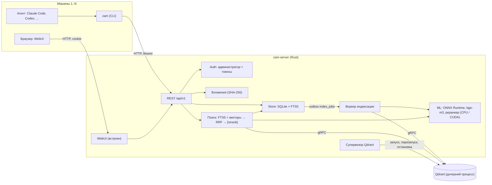

# ZeroAIMemory: архитектура

Компоненты сервера, принципы хранения и каталог данных (перенесено из README 2026-11-28). Полностью — [ТЗ §4–§6](specs/2026-10-17-zeroaimemory-tz.md).



Принципы (ТЗ §4.1):

- **Источник истины — SQLite и файлы вложений.** Qdrant — производный индекс, он
  пересобирается из таблицы `embeddings` без инференса.
- **Ядро — REST.** CLI, WebUI и MCP (`/mcp`, с M4) работают через него.
- **История только дописывается.** Ревизии не перезаписываются, удаление мягкое.
- **Самодостаточность.** Модели скачиваются по закреплённым ревизиям и SHA-256 и
  исполняются в процессе сервера. ONNX Runtime подгружается динамически, поэтому без него
  сервер стартует в режиме FTS-only.

Каталог данных (`data_dir`, ТЗ §6.1):

```
<data_dir>/
  system.db                      # пользователи, токены, сессии WebUI, аудит, настройки, реестр решений
  users/<user_id>.db             # вся память пользователя: узлы, ревизии, чанки, FTS, эмбеддинги, очередь
  blobs/<user_id>/<aa>/<sha256>  # вложения
  models/<id>/                   # ONNX-модели (ml.models_dir), LICENSE и model.toml в каждой
  qdrant/                        # рабочий каталог управляемого Qdrant: config/zam.yaml, storage/, qdrant.pid
  previews/<user_id>/<sha256>/  # кэш превью документов (лист, миниатюра, текст; можно удалить)
  backups/                       # копии zam-server backup и автокопии (M6; [backup] dir — другой каталог)
  logs/
```

Qdrant в режиме `managed` (по умолчанию) слушает только `127.0.0.1` и получает новый
API-ключ при каждом старте. Он привязан к процессу сервера: на Windows через Job Object, на
Linux через `PR_SET_PDEATHSIG`. При падении сервер перезапускает его с задержкой от 1 до
60 с, после 5 падений за 10 минут переходит в режим деградации. Режим `external` подключает
уже работающий Qdrant. Подробности — в ТЗ §4.3 и разделе «Qdrant» инструкции по установке.
